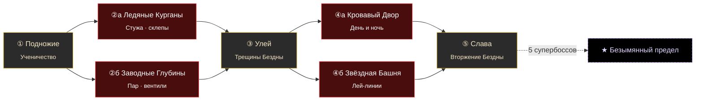

<div align="center">


# Slay the Requiem

**Мод-переосмысление для Slay the Spire 2, вдохновлённый сборкой Skyrim RFAB / Requiem**

*Выносливость и мана, снаряжение со слотами, алхимия и яды, пантеон, трансформации, лагерь,<br>
пять актов с развилками, Камень Памяти и враги, которые бьют больнее.*

[](https://github.com/Riyozaki/SlayTheRequiem/actions/workflows/ci.yml)


[**Возможности**](#-возможности) ·
[**Путь через Шпиль**](#-пять-актов) ·
[**Установка**](#-сборка-и-установка) ·
[**Документация**](docs/README.md) ·
[**Дорожная карта**](docs/ROADMAP.md) ·
[**Changelog**](CHANGELOG.md)

</div>

---

> [!WARNING]
> **Pre-alpha.** Весь код мода (~24 тыс. строк C#) написан по исходникам BaseLib и декомпилированной игре,
> но **ещё ни разу не запускался в Slay the Spire 2**. Чистая логика (`Core/`) компилируется и проходит тесты в CI,
> остальное ждёт первой сборки с игрой — ошибки компиляции и баланса неизбежны. Помощь с первой сборкой очень приветствуется!

## ✦ Что это

Slay the Requiem — не перенос Скайрима в Шпиль, а **перевод идей Requiem на язык карточного рогалика**.
Каждое решение в бою стоит ресурса тела, каждая находка весит, каждый бог чего-то требует,
а смерть — не конец забега, а повод вернуться к началу акта со шрамами.

<table>
<tr>
<td width="33%" valign="top">

### ◆ Тело и магия
**Выносливость** оплачивает атаки, **мана** — заклинания. Устал — бьёшь слабее, на надрыве платишь ♥.
Пять школ магии, 33 заклинания, предрасположенность героя к школам и трактаты.

</td>
<td width="33%" valign="top">

### ⚔ Снаряжение и груз
Слоты оружия, брони и бижутерии, классы брони, **груз** и рюкзак. Латы, Раскол и Пробитие,
сопротивления стихиям, комплекты, заточка, перековка и зачарование душами.

</td>
<td width="33%" valign="top">

### ☠ Стихии и алхимия
Огонь, холод, разряд, яд, хворь, кровотечение и свет — **у каждой своя механика**.
Варка зелий и ядов из реагентов, яды на клинок, токсины и настои.

</td>
</tr>
<tr>
<td valign="top">

### ✧ Пантеон
10 **Знамений** у Нео, 10 Небесных с благословениями и облачениями, 8 **Князей Бездны**
с дарами и ценой. Праведность: Праведный → Запятнанный → Отступник.

</td>
<td valign="top">

### 🜏 Трансформации и Пути
Праведник, **Дитя Ночи**, Носитель Зверя, Вестник → **Лич**, Заводное сердце.
13 **Путей Героя** с Сущностями, Знаками и собственными картами.

</td>
<td valign="top">

### 🔥 Лагерь вместо костра
Очки привала: отдых, кузня, варка, готовка, зачарование, молитва, медитация, тренировка.
**Летопись героя** — уровни, характеристики и деревья навыков на 69 узлов.

</td>
</tr>
<tr>
<td valign="top">

### 🛒 Лавки
Странник, Оружейник, Чародей, Травница и другие: свои ассортименты, цены, **доверие 0–3**,
продажа, заказы, кража — и всё это в кооперативе.

</td>
<td valign="top">

### 🕯 Камень Памяти
Гибель — откат к началу акта. **Свечи Реквиема** ограничивают возвраты,
каждое возвращение оставляет **Шрам**, а убийца ждёт реванша.

</td>
<td valign="top">

### 💀 Враги злее
Выносливость и стойкость у врагов, **13 аффиксов**, 21 элита в 7 актах,
**8 супербоссов** за Багровым порталом и уровни сложности «Реквием» 0–10.

</td>
</tr>
</table>

## 🗺 Пять актов



Новые акты построены на `CustomActModel` с картой шириной 9 и собственными правилами. После босса каждого акта
открывается **Багровый портал** к супербоссу: Чёрный Странник, Жнец Курганов, Мастер-кузнец Глубин,
Посланник Разрушителя Врат, Владыка Кровавого Двора, Первый Призыватель, Пожиратель Миров —
а за пятью победами ждёт Тень Без Имени. «Короткий забег» проходит только акты 1 → 3 → 5.

## 📊 В цифрах

| Контент | | Контент | |
|---|---:|---|---:|
| Карты (герои, заклинания, Пути) | **270** | Силы и статусы | **100** |
| Реликвии и снаряжение | **154** | Зелья и яды | **72** |
| Новые враги | **57** | Встречи (элиты, супербоссы) | **36** |
| События | **9** | Чары карт | **6** |
| Ключей локализации (RU + EN) | **2 × 2135** | Настроек мода | **21** |

Герои системы — **Латоносец** (Ironclad), **Безмолвная** и **Регент**, каждый с происхождениями и предысториями.
Некробиндер и Дефект появляются как облики трансформаций.

## 🛠 Сборка и установка

Нужно: Slay the Spire 2 (≥ 0.107), [.NET 9 SDK](https://dotnet.microsoft.com/download/dotnet/9.0),
мод [BaseLib](https://github.com/Alchyr/BaseLib-StS2) ≥ 3.3.0 и, для `.pck`, [MegaDot](https://megadot.megacrit.com/) (Godot 4.5.1 mono).

```bash
git clone https://github.com/Riyozaki/SlayTheRequiem.git
cd SlayTheRequiem
dotnet build mod/SlayTheRequiem.csproj     # DLL (+ .pck) копируются в <игра>/mods/SlayTheRequiem/
```

Путь к игре определяется автоматически; если нет — скопируйте `mod/Directory.Build.props.example`
в `mod/Directory.Build.props` и пропишите `Sts2Path` / `GodotPath`. Подробности — в [mod/README.md](mod/README.md).

Все системы мода включаются и выключаются в настройках (BaseLib → Slay the Requiem): пять актов, супербоссы,
уровень «Реквием», Камень Памяти, Пантеон, лавки и другое.

### Тесты без игры

```bash
dotnet test mod/SlayTheRequiem.Tests                  # xUnit: правила Core/
python3 -m unittest discover -s tools/sim             # Python-зеркало правил
python3 tools/ci/check_loc.py                         # локализация: RU = EN, у каждой модели есть название
```

## 📁 Структура

```
mod/
├─ SlayTheRequiemCode/     C#-код мода
│  ├─ Core/                чистые правила без зависимостей от игры (тестируются в CI)
│  ├─ Acts/ Monsters/      пять актов, элиты, супербоссы
│  ├─ Cards/ Spells/ Powers/ Relics/ Potions/ Equipment/
│  ├─ Alchemy/ Pantheon/ Transformations/ Progression/ Shops/ Rollback/
│  └─ Net/                 кооператив (сообщения BaseLib, голосования)
├─ SlayTheRequiem/         ресурсы: localization/{eng,rus}, data/*.csv
└─ SlayTheRequiem.Tests/   xUnit-тесты Core
tools/
├─ sim/                    Python-зеркало правил и тесты
├─ loc/                    генератор локализации (build_loc.py)
├─ markup/                 таблицы атак и монстров (CSV)
└─ ci/                     проверки для GitHub Actions
docs/                      дизайн-документы 01–15, техплан, дорожная карта
```

## 🧭 Статус разработки

| Этап | Содержание | |
|---|---|:---:|
| 0 | Каркас мода, ресурсы ◆/✦, разметка ванильных атак | ✅ |
| 1 | Враги, стихии, Латоносец, снаряжение | ✅ |
| 2 | Мана, школы магии, 33 заклинания, Регент | ✅ |
| 3 | Алхимия, Безмолвная, происхождения, аффиксы, Атаманша | ✅ |
| 3.5–3.6 | Лавки, Камень Памяти, кооператив | ✅ |
| 4 | Пантеон: Знамения, Небесные, Князья Бездны | ✅ |
| 5 | Лагерь и прогрессия героя | ✅ |
| 6 | Трансформации и Пути Героя | ✅ |
| 7 | Пять актов, элиты, супербоссы, «Реквием» 0–10 | ✅ |
| 8 | **Первая сборка в игре**, плейтест, визуал, публикация | 🚧 |

✅ — код написан (без сборки в игре). Подробно — в [дорожной карте](docs/ROADMAP.md).

## 🤝 Как помочь

Самое ценное сейчас — **собрать мод с игрой** и прислать ошибки компиляции или поведения.
Шаблоны для [багов](https://github.com/Riyozaki/SlayTheRequiem/issues/new?template=bug_report.yml) и
[идей](https://github.com/Riyozaki/SlayTheRequiem/issues/new?template=idea.yml) — в Issues, правила — в [CONTRIBUTING.md](CONTRIBUTING.md).

## 🙏 Благодарности

- **Mega Crit** — за Slay the Spire 2.
- **Alchyr** — за [BaseLib](https://github.com/Alchyr/BaseLib-StS2) и шаблон мода.
- Авторы **Requiem** и **RFAB** для Skyrim — за идеи, которые здесь переводятся на язык карт.

<div align="center"><sub>Slay the Requiem — фанатский мод, не связан с Mega Crit, Bethesda и авторами Requiem/RFAB.</sub></div>
