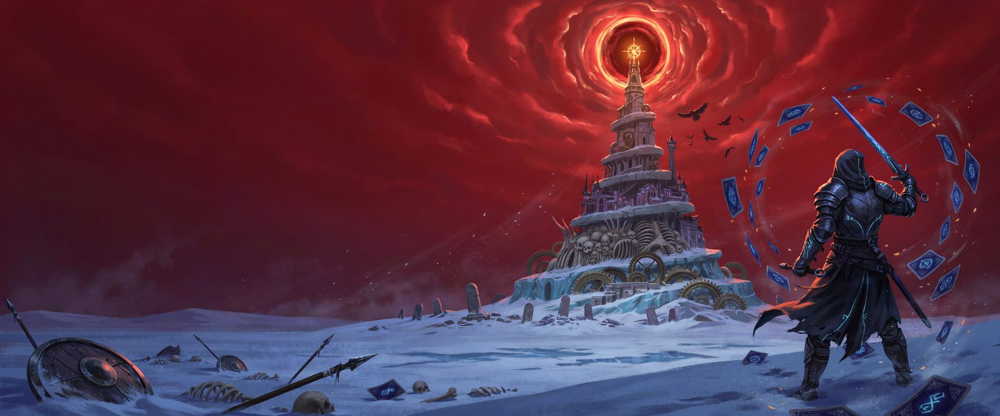
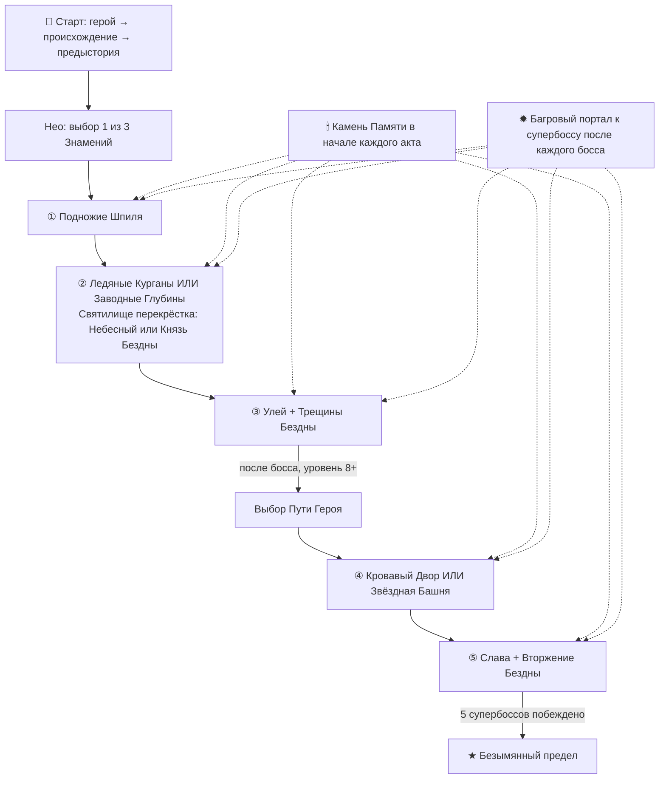

<div align="center">



# Путеводитель по Slay the Requiem

*Всё, что меняет мод, — на одной странице: от первого удара до Тени Без Имени.*

</div>

> [!NOTE]
> Это выжимка из [дизайн-документов](design/) — без формул и технических деталей. Числа — стартовые ориентиры и
> поменяются после плейтеста. Пометка **🔜** — механика задумана, но в коде её пока нет; всё остальное написано
> (и, как и весь мод, ещё ждёт первой сборки в игре).

## Содержание

| | | |
|---|---|---|
| 🧭 [Забег целиком](#-забег-целиком) | ◆ [Тело героя](#-тело-героя-выносливость-мана-груз) | 🛡 [Защита](#-защита) |
| 🔥 [Стихии и статусы](#-стихии-и-статусы) | 👤 [Герои и происхождения](#-герои-происхождения-предыстории) | ✦ [Магия](#-магия) |
| ⚔ [Снаряжение](#-снаряжение) | ⚗ [Алхимия](#-алхимия) | 🏕 [Лагерь](#-лагерь) |
| 📜 [Слава и уровни](#-слава-уровни-навыки) | ☀ [Пантеон](#-пантеон) | 🜏 [Трансформации и Пути](#-трансформации-и-пути-героя) |
| 🛒 [Лавки](#-лавки) | 🗺 [Пять актов](#-пять-актов) | 💀 [Враги](#-враги) |
| 👑 [Супербоссы](#-супербоссы) | 🕯 [Камень Памяти](#-камень-памяти) | ⚖ [Уровни «Реквием»](#-уровни-сложности-реквием) |
| 🤝 [Кооператив](#-кооператив) | ⚙ [Настройки](#-настройки-мода) | 🧪 [Для тестеров](#-для-тестеров-консоль) |

---

## 🧭 Забег целиком

Шесть столпов, на которых держится мод:

1. **Тело — ресурс.** Энергия решает, *сколько* действий; выносливость — *сколько и насколько сильных* ударов; мана — *сколько магии*.
2. **Груз — это выбор.** У каждой карты и каждой железки есть вес. «Брать всё подряд» больше не стратегия.
3. **Стихия — это механика, а не цвет урона.** Огонь, холод, разряд, яд, хворь, кровь и свет работают по-разному.
4. **Враг — это продуманный противник.** Фракция, стихия, снаряжение и аффиксы: каждый элитник читается и требует плана.
5. **Решения с ценой.** Знамение — одно на забег, дары Бездны — с Ценой, трансформации — с минусами.
6. **Читаемость прежде всего.** Никаких скрытых процентов: состояния ступенчатые, шансы — счётчики.



---

## ◆ Тело героя: выносливость, мана, груз

У каждого существа — героя, врага, призванного союзника — **три шкалы**: ♥ Здоровье, ◆ Выносливость, ✦ Мана.
У героя ещё есть ⚖ **Груз**.

```
 ┌───────────────────────────────────────┐
 │ ♥ 78/85   ◆ 6/8 (+3)   ✦ 2/4 (+1)      │   в скобках — прирост в начале хода
 │ ⛨ Латы 2  ◎ Стойкость 3   ⚖ 27/32      │
 └───────────────────────────────────────┘
```

### ◆ Выносливость — сила удара

Каждая **Атака** стоит ◆ (по умолчанию — столько же, сколько энергии, минимум 1; тяжёлое оружие +1, кинжалы −1).
Бой начинается с полной шкалой, каждый ход она пополняется.

| Состояние | Когда | Что происходит |
|---|---|---|
| 😤 **Бодр** | ◆ не меньше половины | обычный урон |
| 😮‍💨 **Устал** | ◆ меньше половины | атаки −25 % урона |
| 🥵 **Изнурён** | ◆ не хватает на цену | атаку всё равно можно сыграть, но −50 % урона и **−2 ♥ за каждую недостающую ◆** (надрыв) |

Выносливость не блокирует ходы, а решает, **насколько сильно** вы бьёте: бесконечные комбо из 0-энергетических атак
упираются в усталость, а тяжёлый удар требует «накопить дыхание». Навыки ◆ не тратят (кроме уворотов, рывков и ударов щитом).

### ✦ Мана — заклинания

**Мана есть у всех героев**, и любой герой может колдовать. Разница — в предрасположенности: воину заклинания даются
дорого, магу — легко (см. [Магия](#-магия)). Мана переносится между ходами. У Регента его звёзды **и есть** мана.

### ⚖ Груз — всё имеет вес

| Что | Вес |
|---|---|
| Обычные и базовые карты | 1 |
| Редкие карты, **проклятия** | 2 |
| Статусы | 0 |
| Снаряжение | 0–5 (украшения лёгкие, двуручники тяжёлые) |

| Перегруз | Штраф |
|---|---|
| +1…+5 | −1 к приросту ◆ |
| +6…+10 | ещё −1 карта в стартовой руке |
| больше +10 | новые вещи и карты не подбираются, пока не избавитесь от лишнего |

Удаление карты теперь ещё и облегчает рюкзак. Лишнее можно оставить в **Сундуке лагеря**.

### Стартовые параметры героев

| Герой | ♥ | ◆ пул / прирост | ✦ пул / прирост | ⚖ | Стойкость |
|---|---|---|---|---|---|
| 🛡 **Латоносец** | 80 | 8 / +3 | 3 / +1 | 32 | 3 |
| 🗡 **Безмолвная** | 70 | 7 / +3 | 5 / +1 | 26 | 2 |
| ✨ **Регент** | 75 | 5 / +2 | 10 / +2 | 24 | 2 |

---

## 🛡 Защита

| Защита | Откуда | Как работает |
|---|---|---|
| ⛨ **Латы** | тяжёлая броня, щиты, заклинания | каждый входящий удар уменьшается на значение Лат (но не ниже 1) — **рой больше не страшен** |
| 💨 **Уворот** | лёгкая броня | заряды за ход: удар, который ранил бы, автоматически отменяется за заряд и **2 ◆** |
| 🌫 **Покров** | тканевые одеяния | первые N урона за ход списываются с ✦ вместо ♥ |
| ◎ **Стойкость** | у всех | порог Ошеломления (см. ниже) |
| 🔰 **Сопротивления** | броня, благословения, зелья | ступени I / II / III = −25 / −50 / −75 % урона стихией и стаков её статуса |

**Ответы на броню:** *Пробитие N* игнорирует N Лат, *Раскол N* временно снижает Латы цели (может увести их в минус —
тогда каждый удар по цели сильнее).

**Ошеломление.** Удары с ключевым словом *Ошеломление X* копят «шаткость». Когда она достигает Стойкости цели —
текущее **намерение врага отменяется**, а Стойкость растёт на 50 % до конца боя (станлока не будет). Боссы
**Непоколебимы**, но у них есть шкала **Слома** — заполнили её, и босс на ход теряет намерение и получает +25 % урона.
Против героя то же правило даёт **Оглушение**: −1 энергия в следующем ходу.

---

## 🔥 Стихии и статусы

У каждого удара есть **тип урона**: физический, огонь, холод, разряд, яд, хворь, магия, свет или истинный.

| Статус | Одной строкой | Отнимает | Срабатывает |
|---|---|---|---|
| 🔥 **Горение** | взрывной урон, плавит Блок ×2, затухает вдвое за ход, **перекидывается с трупов**, глушит регенерацию | ♥ / Блок | в конце хода носителя |
| ❄ **Озноб** | холодный урон бьёт и по ◆; на 0 ◆ враг **Обледеневает** и теряет атаку | ◆ | в начале хода |
| ⚡ **Статика** | выжигает ✦; когда маны нет — бьёт током. Заклинание мага без маны **срывается** | ✦ / ♥ | в начале хода |
| ☠ **Яд** | как в игре: стабильно, мимо Блока, −1 за ход | ♥ | в начале хода |
| 🦠 **Хворь** | не тикает сама: **запрещает лечение** и усиливает каждый тик Яда | лечение | — |
| 🩸 **Кровотечение** | ранит носителя, **когда он атакует** — наказание за многоударные атаки | ♥ | при атаке |
| ☀ **Сияние** | свет бьёт нежить, вампиров и Бездну ×2 и снимает их особые защиты | — | сразу |
| 🔨 **Раскол** | снижает Латы цели | Латы | −1 за ход |

<details>
<summary><b>Прочие эффекты</b></summary>

| Эффект | Правило |
|---|---|
| **Паралич** | цель пропускает намерение; у боссов — Ошеломление вместо этого |
| **Поглощение заклинаний N** | первые N заклинаний за ход не действуют на существо и дают ему ✦ |
| **Оберег N** | «Блок против заклинаний»: поглощает их урон и стаки статусов |
| **Призрачность** | физический урон −75 %, если оружие не серебряное; заклинания и стихии бьют полностью |
| **Плащ стихии N** | атакующий в ближнем бою получает N урона стихией и её статус |
| **Аура стихии** | все враги носителя получают уязвимость к стихии |

</details>

**🔜 Реакции стихий** (опциональный модуль): *Пар* (Горение + Озноб — мгновенный урон суммой), *Ядовитый дым*
(Горение + Яд — яд на соседей), *Хрупкость* (Статика + Озноб — следующий удар мимо Лат), *Гниль* (Кровотечение + Хворь).

---

## 👤 Герои, происхождения, предыстории

```
Герой (3)  →  Происхождение (пассив + сдвиг статов)  →  Предыстория (готовый архетип: стартовые карты и вещи)
```

В системе мода играбельны **Латоносец**, **Безмолвная** и **Регент**. Некробиндер и Дефект стали
**обликами трансформаций**: Лича и Заводного сердца.

<details>
<summary><b>🛡 Латоносец — кланы</b></summary>

| Происхождение | Пассив | Предыстории |
|---|---|---|
| **Инеерождённые** | сопротивление холоду I; Озноб на вас спадает сразу | Зверобой-духовидец (дух-волк, затем саблезуб и медведь), Скальд (Кличи с первого боя), Хладовяз («Ледяной ветер», аура уязвимости к холоду) |
| **Горнокровные** | сыграли 3+ Атаки — в ход врага −25 % урона | Берсерк, Браконьер, Громовой шаман |
| **Дюнные клинки** | прирост ◆ растёт, когда она на исходе; сопр. ядам II | Брат Рассвета, Заговорщик, Клинок-ансей |
| **Цитадельцы** | каждые 3 уровня — лишнее очко характеристик | Легионер, Посланник, Маг цитадели |

</details>

<details>
<summary><b>🗡 Безмолвная — племена</b></summary>

| Происхождение | Пассив | Предыстории |
|---|---|---|
| **Лунная порода** | видит скрытые намерения; когти бьют как кинжал | Беглец, Плут, Сумеречный певец |
| **Сыны Чащи** | звери не нападают в первый ход; сопр. хвори II | Ветроплясун, Охотник, Отшельник |
| **Тинники** | регенерация при ♥ < 50 %; сопр. ядам и хвори | Гладиатор, Тёмный ящер, Ядовяз |

</details>

<details>
<summary><b>✨ Регент — звёздные династии</b></summary>

| Происхождение | Пассив | Предыстории |
|---|---|---|
| **Златокровные** | первое заклинание хода −1 ✦; но уязвимость к магии | Юстициар, Чародей теней, Волшебник |
| **Туманные** | сопр. магии I; первое вражеское заклинание поглощается | Рыцарь, Зачарователь, Призыватель |
| **Пеплорождённые** | дары трёх Князей Бездны без условий; сопр. огню I | Ординатор, Пепельный кочевник, Ученик Грибной Башни |

</details>

**Бродяга** — для всех: без особой детали, но +5 ♥, +1 ◆, +1 ✦, +3 груза и бесплатное удаление карты.

### 📣 Кличи

Клич не уходит в сброс, а **ставится на полку и через N ходов возвращается в руку**.
Боевой клич, Безжалостная сила, Огненный выдох, Морозный выдох, Зов грозы, Разрыв души (добивает ослабленных).

---

## ✦ Магия

**Пять школ:** 🔥 Разрушение · 💚 Восстановление · 🪨 Изменение · 👻 Колдовство · 🎭 Иллюзия.
**Пять ступеней:** Новичок → Ученик → Адепт → Эксперт → Мастер (мастерские заклинания — ритуалы на 5–8 ✦).

### Владение школой (0–5) решает цену

`разрыв = ступень заклинания − владение школой`

| Разрыв | Состояние | Эффект |
|---|---|---|
| ≤ −2 | ✨ **Лёгкость** | −1 ✦ |
| −1…0 | **Свободно** | как на карте |
| 1 | **Неумело** | ✦ ×1.5 |
| 2 | **С трудом** | ✦ ×2 и эффект −25 % |
| ≥ 3 | ⛔ **Непостижимо** | сыграть нельзя |

> Латоносец с владением 0 спокойно кастует «Огненную стрелу» за 2 ✦ раз в пару ходов. «Огненный шар» ему
> непостижим — пока он не вложит пару очков в ветку Разрушения.

Владение растёт от узлов школ в деревьях навыков (родная школа — 1 очко, чужая — 2), очков характеристик и
**Трактатов** из Чародейской лавки. Школа попадает в награды за бой, когда владение ≥ 1.

<details>
<summary><b>Примеры заклинаний по школам (всего 33 + 5 Иллюзии)</b></summary>

| Школа | Заклинания |
|---|---|
| 🔥 **Разрушение** | Искры, Огненная стрела, Ледяной ветер, Огненная руна, Плащ пламени, Огненный шар, Ледяное копьё, Шаровая молния, Стена пламени, Буран; подписные: *Метеор*, *Ледяная гробница*, *Цепь молний* |
| 💚 **Восстановление** | Исцеляющий свет, Малый оберег, Солнечный луч, Ядовитый спрей, Кольцо стойкости, Изгнание нежити, Мор, Солнечная вспышка, Великий оберег |
| 🪨 **Изменение** | Дубовая плоть, Импульс, Перышко, Каменная плоть, Паралич, Поглощение, Драконья кожа, Массовый паралич |
| 👻 **Колдовство** | Призванный клинок, Волк-дух, Поднять мертвеца, атронахи огня / льда / грозы, Изгнание, Страж Бездны, Рыцарь-дух |
| 🎭 **Иллюзия** | Приглушённые шаги, Смятение, Страх, Невидимость, Безумие |

</details>

**Руны** ложатся на полку и срабатывают, когда враг атакует. **Плащи** обжигают атакующих. **Контроль** (Иллюзия,
Паралич) ограничен ♥ цели по ступени: Новичок — до 20 ♥, …, Мастер — любые не-боссы.

Зеркальное правило для магов — **«Неумелый хват»**: Регент с двуручником, тяжёлым щитом или арбалетом платит +1 ◆
и бьёт на 25 % слабее, пока не возьмёт узел «Ратного дела».

---

## ⚔ Снаряжение

Снаряжение — это реликвии, привязанные к **слоту**, с весом и улучшениями. Остальные реликвии лежат в рюкзаке.

```
          [Голова]
 [Амулет]  [Тело]  [Плащ]
 [Кольцо] [Руки]  [Кольцо]
 [Правая рука] [Ноги] [Левая рука]
            [Пояс: яды и свитки]
```

**Материалы (ступени I–V):** Железо → Сталь → Небесное серебро / Чешуйчатая сталь → Чёрный обсидиан / Драконья кость →
Вечный лёд / Бездонное. Кузня в лагере и Заточка у Оружейника улучшают предмет до +2.

### Оружие задаёт стиль боя

Карта **Удар** и все *Оружейные* атаки берут урон оружия, а тип оружия даёт свойство:

| Тип | ◆ | Свойство |
|---|---|---|
| 🗡 Кинжал | −1 | **Подлый:** по цели без атакующего намерения ×1.5 + Кровотечение |
| ⚔ Меч | ±0 | **Острый:** каждая 3-я атака — крит ×1.5 |
| 🪓 Топор | ±0 | **Рубящий:** +урон по раненым (♥ < 50 %) |
| 🔨 Булава | ±0 | **Дробящий:** Раскол за удар |
| 🔱 Копьё | ±0 | **Выпад:** контрудар первому атакующему в ход врага |
| ⚒ Двуручное | +1 | свойство одноручного ×2 + Ошеломление |
| 🏹 Лук | ±0 | **Выстрел:** не вызывает Плащи и шипы врага |
| 🎯 Арбалет | +1 | Пробитие 2, затем ход перезарядки |
| ✊ Пустые руки | ±0 | **Дуэлянт:** +1 прирост ◆ |

### Броня — три класса

| Класс | Защита | Цена |
|---|---|---|
| **Тяжёлая** | Латы, Стойкость | 3+ части → −1 прирост ✦ |
| **Лёгкая** | заряды Уворота, +◆ | не работает рядом с тяжёлой |
| **Одеяние** | Покров, заклинания школы дешевле | почти не защищает от ударов |

**Комплекты** дают бонусы за 2 и 4 части (Железо ополченца, Шкуры загонщика, Кольчуга контрабандиста и др.).
**Кольца и амулеты** — главная арена сочетаний; у пар колец есть скрытые синергии.
**Артефакты** выпадают с элит и супербоссов — каждый с механикой, а не только с числами.

### Зачарование

- **Снаряжение** зачаровывается на Зачаровальном столе в лагере за **Камень душ** (малый / большой / чёрный — с элит и боссов):
  здоровье, выносливость, магия, сопротивления, груз, мощь оружия.
- **Оружейные клейма** (огонь, холод, разряд, поглощение) работают **по зарядам** и перезаряжаются камнем.
- **Карты** получают чары: Пламенная, Морозная, Грозовая, Облегчённая (−1 вес), Дыхательная (−1 ◆), Двойная.

🔜 Маски Курганов (коллекция из 8 + Девятая), посохи и свитки, «кукла» героя со сменой спрайтов.

---

## ⚗ Алхимия

**10 реагентов** падают с врагов по фракциям и типу атаки и хранятся в Сумке травника (до 12 штук):
Кровяной мох, Синецвет, Жёлтая кислица, Пепельная и Ледяная соль, Грозовой кристалл, Ночная поганка, Прах мертвеца,
Драконий порошок, Душистая слеза.

**Варка** в лагере: 2–3 реагента → зелье или яд, 24 рецепта, ступени I–V. Всего **72 зелья и яда**.

| Группа | Примеры |
|---|---|
| **Восполнения** | Здоровья, Выносливости, Маны |
| **Длительные** | Омоложения, Второго дыхания, Ясности — эффект на 4 хода |
| **Усиления на бой** | Великана, Рыцаря, Берсерка, Чародея, Стихийной защиты, Невидимости, Ночного зрения |
| **Особые** | Панацея, Эликсир лунного сахара, Слёзы Матери Очага (воскрешение) |

**Яды на оружие** наносятся из Пояса и тратятся по зарядам на каждой Оружейной атаке: Прямой урон, Токсин, Гнилец (Хворь),
Истощение (−◆), Пустоцвет (−✦), Слабость, Разъедание (Раскол), Паралитик, Комбинированный. Нежить и конструкты
равнодушны к большинству ядов — но не к Прямому урону, Разъеданию и Пустоцвету.

---

## 🏕 Лагерь

Костёр стал **лагерем**: каждый привал даёт **2 очка**, действия стоят 0–2.

| Действие | Цена | Эффект |
|---|---|---|
| 😴 Отдых | 2 | лечит 30 % ♥, снимает Усталость похода |
| 🌙 Короткий привал | 1 | лечит 15 % ♥ |
| ⬆ Улучшить карту | 2 | как в игре |
| ⚒ Кузня | 2 | снаряжение +1 |
| ⚗ Варка | 1 | зелье или яд из реагентов |
| ✨ Зачарование | 2 | чары за Камень душ |
| 🍲 Готовка | 1 | еда на 3 боя |
| 🙏 Молитва | 1 | сменить благословение / искупление |
| 🧘 Медитация | 1 | +1 ступень ◆ или ✦ на следующий бой |
| 📈 Развитие | 0 | потратить очки уровня |
| 📦 Сундук | 0 | оставить или забрать вещи |
| 🔥 Отогреться | 0 | только в Курганах: 2 боя без Стужи |

**Ветка «Выживание»** (3 яруса × 3 узла) добавляет очки лагеря, Готовку, лучший привал, акклиматизацию и знание трав.
**Еда** даёт Сытость на 3 боя — главный способ поднять приросты ◆/✦ без снаряжения; **Пир** — всё сразу на 1 бой.
**Усталость похода** (с «Реквиема» 5): каждые 3 узла без Отдыха — −1 пул ◆.

🔜 Вьючный зверь, постройки лагеря как метапрогресс.

---

## 📜 Слава, уровни, навыки

- **Слава** за бои: обычный 1, элита 3, босс 6. **Уровень героя 1–15.** Летопись героя ведёт счёт.
- За уровень — **2 очка характеристик**: +4 ♥ / +1 пул ◆ / +1 пул ✦ / +3 груза / +1 владение школой.
- Каждые **3 очка в одну ось** — ступень-бонус:

| Ось | I | II | III |
|---|---|---|---|
| ♥ Крепость тела | сопр. ядам I | +6 груза | Латы +1 |
| ◆ Неудержимый натиск | +1 прирост ◆ | атаки +1 | первая атака хода без ◆ |
| ✦ Гибкость ума | +1 прирост ✦ | первое заклинание хода −1 ✦ | Покров 3 |

- Каждый 2-й уровень — **очко навыка**. **69 узлов**: общие ветки Ремесло, Ратное дело, Выживание; по 4 ветки у героя
  (Латоносец — Одноручное, Двуручное, Блок, Тяжёлая броня; Безмолвная — Кинжалы, Стрельба, Уклонение, Яды) и 5 школ магии,
  **открытых всем**.

---

## ☀ Пантеон

### 🌌 Знамения — одно на забег

У Нео вместо первого дара — выбор **1 из 3** (на «Реквиеме» 8+ — из всех 10).

| Знамение | Суть |
|---|---|
| ⚔ **Клинка** | +♥, атаки +1, «Устал» не снижает урон |
| 🏰 **Бастиона** | Латы +1, сопротивление всем стихиям, Стойкость |
| 👁 **Ока** | больше маны, враги уязвимы к магии |
| 🧽 **Губки** | огромный пул ✦ и Поглощение, но медленный прирост |
| 🕯 **Обряда** | +слот призыва, Колдовство дешевле |
| 🐴 **Ноши** | +10 груза, иммунитет к Обледенению и Параличу |
| 🎭 **Ловкача** | **Кража** в лавках, +15 % золота |
| 📣 **Гласа** | Кличи быстрее и сильнее, товары реже |
| 🌑 **Тени** | первый ход боя — Невидимость, удары из неё ×2 |
| 🐍 **Змея** | яды сильнее, больше зарядов на оружии |

**Осколки отлива** (событие «Шесть камней у воды»): шесть временных камней до конца акта — у каждого плюс и минус.

### ⚖ Праведность

**Праведник** → **Запятнанный** → **Отступник**. Кража и грабёж опускают на ступень, договор с Князем Бездны или
тёмная трансформация — сразу в Отступники. Искупление в Святилище — раз за акт.

### ☀ Небесные — благословения

Узел **Святилище** (часть «?» с акта 2). Держать можно **одно** благословение. **Комплект бога:** Благословение +
Амулет + Облачение, а с «Небесным щитом» Праведника — **Дух божества**.

**Крылатый Час** · **Отец Наковальни** · **Хранитель Свитков** · **Дева Зеркал** · **Владычица Ветров** ·
**Матерь Очага** · **Страж Порога** · **Щит Милосердия** · **Громовой Венценосец** · **Солнечный Лучник**

### ⛧ Князья Бездны — дары с Ценой

**Тёмное святилище.** Каждый дар — это **Дар** (сразу), **Цена** (навсегда) и **Обет** — условие, после которого дар
усиливается.

| Князь | Дар | Цена |
|---|---|---|
| **Повелитель Мора** | атаки накладывают Хворь | болезнь в начале каждого акта (после Обета — болезни с плюсами) |
| **Сумеречная Вдова** | невидимость в первый ход | −5 макс. ♥ |
| **Ткачиха Паутины** | вампиризм по отравленным | отдых лечит хуже |
| **Разрушитель Врат** | Бездонное оружие сильнее | Отступник навсегда |
| **Князь Измены** | атаки +2, Пробитие | призывы получают больше урона |
| **Хмельной Князь** | две Сытости разом | «Похмелье» в руке |
| **Отверженный** | регенерация после боя | лавки дороже, праведность закрыта |
| **Сумеречная Звезда** | ♥, ✦, сопротивления | карта колоды портится в конце акта |

---

## 🜏 Трансформации и Пути Героя

**Одно мировоззрение и один Путь** за забег. Каждая форма меняет облик героя, даёт особую карту и Сущность.

| Форма | Как получить | Суть |
|---|---|---|
| 😇 **Праведник** | обет у алтаря | Ореол спасает при ♥ < 50 %, карта «Кара»; ступени до Духа божества |
| 🦇 **Дитя Ночи** | укус Кровавой знати | **Жажда 0–4**: чем голоднее, тем сильнее и уязвимее; «Укус» кормит; «Крылья ночи»; ступень Кровавого лорда |
| 🐺 **Носитель Зверя** | Луна над чащей, Вожак стаи | «Зов луны»: форма зверя со звериной колодой; ветки Клык / Долгая ночь / Альфа |
| 💀 **Тёмный договор → Вестник → Лич** | Шёпот из урны → Хранитель Гробницы → Филактерия | Стойки Чума / Раздор / Распад; кость вместо плоти, Взрыв смерти, Филактерия воскрешает раз за забег |
| ⚙ **Заводное сердце** | Сердце Глубин, Мастер-кузнец | Латы и иммунитеты; **сферы стихий** бьют врагов каждый ход |

**Путь Героя** — после босса 3-го акта при уровне 8+: выбор 1 из 3. Путь = Сущность + 3 карты в награды + Знак Пути (снаряжение).

| Путь | Суть |
|---|---|
| **Паладин** | аура Лат, «Кара» бесплатна |
| **Чёрный рыцарь** | аура страха, атаки лечат |
| **Чемпион** | ошеломляет даже Непоколебимых |
| **Варвар** | ярость на низком ♥: +50 % урона, атаки без ◆ |
| **Монах** | безоружные удары растут с уровнем |
| **Ассасин** | Шаг тени: удар в спину ×2 |
| **Губитель** | яд на целях с Хворью не спадает |
| **Мистический лучник** | выстрелы несут стихию последнего заклинания |
| **Повелитель стихии** | подписное заклинание: Метеор, Ледяная гробница или Цепь молний |
| **Боевой маг** | все Плащи сразу, атаки + стихийный урон |
| **Отражатель** | Оберег возвращает урон заклинаний |
| **Медиум** | +слот призыва, призывы сильнее |
| **Перерождённый** | сменить предысторию и перераспределить очки |

Тёмные формы несовместимы друг с другом и с Праведником; Заводное сердце уживается с Праведником.

---

## 🛒 Лавки

Вместо одного магазина — **виды лавок** с собственной витриной. Вид выбирается по сиду и этажу, первая лавка акта —
всегда Странник.

| Лавка | Что продаёт |
|---|---|
| ⚖ **Странник** | карты, зелья, реликвии + одна вещь снаряжения |
| ⚒ **Оружейник** | оружие, броня класса героя, щиты — по ступени акта |
| ✧ **Чародейская** | заклинания по владению, Трактаты владения |
| ⚗ **Травница** | зелья и яды на оружие |

- **Прилавок:** продажа снятого снаряжения (35 %, при доверии 3 — 50 %), Заточка, Перековка, Варка, наборы реагентов,
  Панацея.
- **Доверие 0–3** к каждому виду лавок: растёт от потраченного золота, даёт скидки, лишний товар, а на 3 — **Заказ**
  нужного предмета в следующей лавке.
- **Кража** (Знамение Ловкача и др.): шанс падает с ценой товара; провал бьёт по ♥, доверию и праведности.
- Золото за бои **×1.3** — покупать теперь есть что.

🔜 Ювелир, Храмовая лавка, Скупщик краденого, Караван, Наставник.

---

## 🗺 Пять актов

Ванильные акты стоят на **нечётных** местах, новые — на **чётных**, у каждого чётного **два варианта**.

| # | Акт | Правило | Супербосс |
|---|---|---|---|
| ① | **Подножие Шпиля** | «Ученичество»: системы вводятся постепенно | Чёрный Странник |
| ②а | 🧊 **Ледяные Курганы** | **Стужа:** Озноб 1 в начале боя, «Отогреться» в лагере. **Запертые склепы** за Когтистые ключи. 🔜 Тьма прячет дальние узлы | Жнец Курганов |
| ②б | ⚙ **Заводные Глубины** | **Перегрев:** каждые 4 хода выброс пара — Горение 3; **вентили** на карте закрывают клапан на 3 боя. 🔜 вентили переключают рёбра карты | Мастер-кузнец Глубин |
| ③ | 🐝 **Улей** | **Трещины Бездны:** каждый 3-й узел превращает бой впереди во **Врата Бездны** | Посланник Разрушителя Врат |
| ④а | 🩸 **Кровавый Двор** | **День и ночь** блоками по 3 ряда: ночью вампиры сильнее (+25 % ♥, Невидимость), но и награда больше | Владыка Кровавого Двора |
| ④б | ✨ **Звёздная Башня** | **Лей-линии:** бой на линии даёт +3 ✦ всем. 🔜 порталы через 2 ряда | Первый Призыватель Чёрной Книги |
| ⑤ | 👑 **Слава** | **Вторжение Бездны:** каждый шаг открывает Врата впереди — гонка | Пожиратель Миров |
| ★ | **Безымянный предел** | тайный финал за 5 супербоссов | Тень Без Имени |

- **Новые акты** — карта шириной **9 колонок** (больше путей и развилок), свои фоны и боссы.
- **«Короткий забег»** — только акты 1 → 3 → 5 с оверлеями мода.
- Враги поздних актов получают надбавку ♥ (Улей +5 %, Слава +15 % и +1 аффикс элитам), потому что герой к ним
  заметно сильнее, чем в обычной игре.

🔜 Новые значки карты: Святилище, Тёмный алтарь, Таверна, Библиотека, Логово, Испытание, Тайник, Засада, Караван и другие.

---

## 💀 Враги

Враги играют по тем же правилам, что и герой, — и **это видно на экране**.

- **◆ у врагов:** атака стоит 1–2 ◆. Устал — бьёт слабее, на нуле — вместо атаки «**Отдышаться**». Холод реально
  отключает атаки.
- **✦ у магов:** заклинательные намерения требуют маны; разряд их срывает.
- **Латы, Стойкость, сопротивления и тип атаки** размечены для всех 113 врагов игры. ♥ врагов +10 % (настраивается).
- **Боссы** Непоколебимы, но **ломаются** — шкала Слома.

### Аффиксы (13)

Обычные враги со 2-го акта — 0–1, элиты — 1, на «Реквиеме» 7+ — 2–3.

| | | | |
|---|---|---|---|
| 🪨 Закалённый | 🔥 Огненный | ❄ Ледяной | ⚡ Грозовой |
| 💚 Выпивающий силы | 💧 Пожиратель маны | 🦇 Вампирический | ☠ Отравленный клинок |
| 🚩 Знаменосец | 🔮 Поглотитель | 😡 Неистовый | 👻 Призрачный |
| 💥 Мститель | | | |

### Фракции

Звери Чащи · Береговые грабители · Курганные мертвецы · Заводные стражи · Отступники Звёздной Башни ·
Кровавый двор · Порождения Бездны · Культ Безликих — у каждой свои сопротивления и слабости.

### Элиты: свои в каждом акте + редкая

Элиты — механически уникальные мини-боссы, а не мешки ♥. В новых актах — 3 элиты мода, в ванильных они **добавляются**
к элитам игры. Редкая элита встречается с шансом 15 %, не чаще раза за акт.

<details>
<summary><b>Все элиты по актам</b></summary>

| Акт | Элиты | Редкая |
|---|---|---|
| ① Подножие | **Атаманша Багряных Ножей** (шайка спит до первого удара), **Вожак стаи** (волки встают, пока жив вожак), **Мшистый старейшина** (регенерация, которую глушит огонь) | Хозяйка котла — пьёт зелья, их можно разбить |
| ②а Курганы | **Хранитель Гробницы** (высасывает ману, рыцари-духи), **Ледниковый великан** (Призрачность, ледяной выдох), **Призрачный клинок** (ритм Адреналина) | Принц Первого Снега |
| ②б Глубины | **Центурион Глубин** (перегрев снимает Латы), **Паучиха-матриарх** (ремонтники), **Механик-отступник** (турели) | Сердце реактора |
| ③ Улей | **Полководец Бездны** (открывает Врата), **Мать чумы** (рой мух в колоду) | Пожиратель роя |
| ④а Двор | **Кровавый вельможа** (укус делает вампиром), **Гаргулья-страж** (камень днём, когти ночью), **Охотник на вампиров** (капканы) | Невеста Владыки |
| ④б Башня | **Чародейка Ильварре** (бьёт в слабую стихию), **Призыватель-отступник** (атронахи), **Зеркальный страж** (бой для воина) | Звёздный экзаменатор — сыграй карту нужного типа |
| ⑤ Слава | **Жрец курганов** (маски и ауры), **Костяной поборник** (неуязвим, пока живы щитоносцы) | Чёрный рыцарь Бездны |

</details>

---

## 👑 Супербоссы

После босса каждого акта открывается **✹ Багровый портал** (на выбор или обязательно — настройка).
Награда: редкая реликвия, **чёрный Камень душ** и **Свеча Реквиема** (не больше одной за забег).

| Акт | Супербосс | ♥ | Главная угроза |
|---|---|---|---|
| ① | **Чёрный Странник** | 220 | дуэлянт: бьёт в слабую стихию, Соли душ зовут призраков — их можно украсть |
| ②а | **Жнец Курганов** | 300 | ледяная коса с вампиризмом, Проклятый клич режет Латы, мертвецы встают |
| ②б | **Мастер-кузнец Глубин** | 320 | Плавильный взрыв, если не закрыты вентили на поле |
| ③ | **Посланник Разрушителя Врат** | 420 | Молот Бездны, Врата лечат его — закрывайте |
| ④а | **Владыка Кровавого Двора** | 450 | Туман (атаки мимо), кокон неуязвимости и слуги-гаргульи |
| ④б | **Первый Призыватель Чёрной Книги** | 430 | Цепь молний, **Слово подчинения**, драконьи яйца — разбейте их до его лечения |
| ⑤ | **Пожиратель Миров, Чёрное Крыло** | 600 | **Полёт** (ближний бой вполсилы), Метеоритный дождь, Безликие жрецы |
| ★ | **Тень Без Имени** | 700 | неуязвима, пока не убита одна из её душ; каждый удар бьёт по всем шкалам |

---

## 🕯 Камень Памяти

> *«Шпиль поёт Реквием по каждому павшему. Но камень у подножия каждого яруса помнит твоё имя.»*

Пять актов — это долго, поэтому смерть не обязательно конец забега.

1. **Отпечаток.** На выходе из стартового узла каждого акта игра запоминает всё: колоду, вещи, золото, уровень,
   праведность, формы.
2. **Смерть.** На экране поражения — кнопка **«Вернуться к Камню Памяти»**, если остались **Свечи Реквиема**.
3. **Возврат.** Вы снова в начале акта, **карта сгенерирована заново** (заучить её нельзя), но **босс прежний**.

| Цена — выберите Шрам | |
|---|---|
| 🩹 **Шрам плоти** | −6 % макс. ♥ |
| 👁 **Шрам души** | проклятие «Предсмертное эхо» в колоду |
| 💰 **Шрам кошелька** | −40 % золота |

**Утешение:** +10 % урона по убийце (**Месть**), половина набранной Славы сохраняется.
Каждый откат снижает счёт забега на 15 %; за победу без единой свечи — бейдж **«Ни одной свечи»**.

---

## ⚖ Уровни сложности «Реквием»

Заменяют Возвышение (по умолчанию уровень = Возвышение + 1).

| Уровень | Название | Что меняется | Свечей |
|---|---|---|---|
| 0 | Странник | враги −25 % ♥, вы получаете −25 % урона | ∞ |
| 1 | Наёмник | мод как задуман | 3 |
| 5 | Ветеран | + Усталость похода | 2 |
| 7 | Легенда | элиты с 2–3 аффиксами, вы получаете +25 % урона | 2 |
| 8 | — | все 10 Знамений на выбор | 1 |
| 10 | **Проклятый** | вы наносите −20 % урона, портал обязателен, старт Запятнанным | **0** |

---

## 🤝 Кооператив

- Лавки, Камень Памяти, карты актов и редкие элиты считаются **одинаково у всех игроков** (броски от сида забега).
- Возврат к Камню — **голосование отряда** (при ничьей решает хост), Свечи общие, Шрам каждый выбирает себе.
- В коопе в Багровый портал входят всегда — без отдельного голосования.
- Нужны **одинаковые настройки мода** у всех игроков.

---

## ⚙ Настройки мода

Все системы включаются и выключаются в меню BaseLib → Slay the Requiem.

| Группа | Настройки |
|---|---|
| **Ядро** | системы мода целиком, надрыв, ♥ врагов (%), автоуворот |
| **Герои** | происхождения Латоносца, Безмолвной и Регента, предыстория («Случайно» / конкретная / «На выбор») |
| **Забег** | пять актов, «Короткий забег», уровень «Реквием», Багровый портал (выкл / на выбор / всегда), широкие карты, виды лавок, кража |
| **Пантеон** | Знамения, Небесные и Князья Бездны |
| **Смерть** | Камень Памяти, число Свечей |

## 🧪 Для тестеров: консоль

В отладочной консоли игры работают команды мода. Префикс мода писать не нужно: `str_card path_garrote`,
`str_card PathGarrote` и `str_card SLAYTHEREQUIEM-PATH_GARROTE` равнозначны. Tab дополняет id.

| Команда | Что делает |
|---|---|
| `str_fight <энкаунтер>` · `str_superboss [id]` | бой с врагами мода · с супербоссом (без id — список) |
| `str_act <n \| id>` · `str_event <id>` · `str_shop <вид>` | акт n или акт мода · событие · лавка: Wanderer, Armorer, Arcanist, Herbalist |
| `str_card <id> [стопка]` · `str_relic <id>` | карта (жетоны тоже; стопка Hand/Deck/Draw/Discard) · реликвия, предмет, фон |
| `str_stamina <n>` · `str_mana <n>` | ◆ и ✦ в бою (◆ можно выше пула) |
| `str_level <n>` · `str_form <форма>` | уровень Летописи · форма: Righteous, Vampire, Werewolf, DarkPact, Herald, Lich, Clockwork |
| `str_memorystone` · `str_stat` | снять Отпечаток Камня Памяти · сводка героя: ◆ ✦ ⚖, Стойкость, уровень, формы |

---

<div align="center">

**Подробнее по каждой системе** — в [дизайн-документах](README.md) · **Что сделано и что дальше** — в [дорожной карте](ROADMAP.md)

<sub>[← на главную](../README.md)</sub>

</div>
