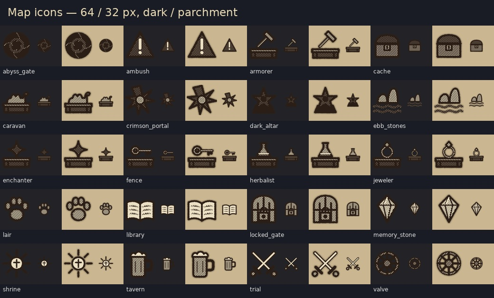

# Визуальное ревью — 18.11.2026

База `8000886` · [основной аудит](main-audit-2026-11-18.md) · [план](../plan/stabilization-plan-2026-11-18.md).

**Рисунки действительно просмотрены**, а не оценены по существованию PNG. Для этого собраны и открыты 16 контактных
листов. Они сохранены в [`assets/2026-11-18/`](assets/2026-11-18/) и доступны ниже.

Это просмотр исходных изображений и тест уменьшения, **не скриншоты игры**. Финальную композицию с ванильными героями,
текстом, интентами, импортом Godot, эффектами и анимацией ещё нужно принять в игровом клиенте.
Звук проверен как данные/файлы, не прослушан как законченный игровой микс.

## 1. Вердикт

У проекта уже есть узнаваемая палитра: иней, медь/латунь, кровь, арканный фиолетовый, пустота. Файлы воспроизводимы,
многие небольшие предметные иконки аккуратны. **Но большая часть персонажного и сюжетного арта пока выглядит как
согласованный процедурный прототип, а не финальный уровень большой атмосферной переработки.**

Главный художественный разрыв — не разрешение файла и не недостаток свечения. Это повторяющиеся геометрические тела,
статичные фронтальные позы, слабая анатомия/материалы/глубина, мало конкретного действия в карточной сцене.
Дополнительные штрихи и bloom сами по себе этого не исправят.

Лучше всего сейчас работают небольшие реликвии и некоторые UI-символы. Больше всего мешают целостности собственные
боевые фигуры рядом с анимированными ванильными, а также карточные иллюстрации без сцены. Карта требует отдельной
пиксельной приёмки: перевод в монохром уже сделан, читаемость автоматически не появилась.

## 2. Фактический объём — без завышения готовности

| Семейство | Что просмотрено | Что говорит манифест |
|---|---|---|
| Карты | 21 большой PNG: 20 собственных иллюстраций + шаблон `card` | 340 моделей, 680 слотов; 40 own / 640 vanilla — два размера одной иллюстрации не две новые картины |
| Монстры и формы | 58 изображений/вариантов, включая смены состояния | 86 моделей; 38 собственных визуалов / 48 ванильных по классификации инструмента |
| Реликвии | 198 основных иконок, включая один шаблон; 4 листа | 203 модели, 609 слотов; 591 own / 18 vanilla — иконка/контур/большая версия считаются отдельно |
| События | Все 34 собственные сцены | Ещё 9 событий используют ванильное изображение |
| Акты | 15 крупных изображений + 15 дополнительных слоёв | 5×6 файлов фона/лагеря/карты, не 30 независимых полноценных локаций |
| Двери | 4 изображения вариантов актов | Отдельный семейный набор |
| UI | Обзорный лист из 48 файлов, в том числе исходные слои оружия; отдельно 20 обработанных слоёв куклы | UI-манифест включает 106 слотов разных назначений |
| Карта | 24 значка узлов в 64/32 px на двух фонах; 12 силуэтов боссов + 12 контуров | Проверка наличия не оценивает различимость |
| Силы, зелья, лагерь | Собственных рисунков для оценки нет | 118 сил и 74 зелья закрыты ванильными изображениями; все 13 действий лагеря используют vanilla fallback |

Общий итог инструмента **833 own / 1118 vanilla / 0 missing** относится к **1951 ожидаемому слоту**.
Это не процент художественной готовности. Наличие своего файла не делает его автоматически лучше корректного
ванильного изображения. При этом заимствованный символ может оказаться неузнаваемым по смыслу без хорошей подсказки.

## 3. Карточные иллюстрации

[Открыть полный лист карт](assets/2026-11-18/cards-01.jpg).

### Что удачно

- Элементы распознаются цветом и крупным знаком: `firebolt`, `poison_spray`, `sparks`, `storm_call`.
- Контраст фокуса относительно фона обычно есть; маленький портрет не перегружен мелким текстом.
- У `blood_lord_stance` есть выразительная тёмная масса и красный акцент; `focused_aim` сообщает идею прицеливания.

### Что не дотягивает

- `blade_spirit` и `bound_blade` — похожий композиционный приём: один центральный вертикальный меч и свечение.
  Различие «призрак клинка / связанное оружие» почти полностью держится на фоне/частицах.
- `blizzard` больше сообщает «геометрические горы», чем опасную бурю в бою; `whirlwind` — парящий топор с дугами,
  а не силовое действие персонажа. Иллюстрация объясняет существительное лучше, чем эффект карты.
- `call_spirit_knight`, `conjure_abyss_guardian` упрощают существо до схемы; их материал и масштаб не ощущаются.
- `terror` читается как улыбающееся лицо в темноте: тональность менее угрожающая, чем механика и мир мода.
- Часто повторяются пустой фон, центральная эмблема, ореол и точки. Набор согласован, но визуально однообразен.
- Шаблон `card` со схематичным белым улыбающимся контуром нужно исключить из финальной поставки как рабочую заглушку.
  **Это не доказанный источник пользовательского `nope`.**

### Что делать

Не перерисовывать сразу все 340 классов: многие из них — меню-жетоны. Сначала составить список **реально видимых боевых
карт** и 3–5 ключевых карт каждого героя. Для каждой написать brief: кто действует, какое действие, на что/где,
эмоция, фокус и читаемость в 250×190. Иллюстрации меню должны остаться отдельным, более простым семейством.

Критерий: без названия можно отличить назначение хотя бы между картами одного архетипа; full-art и small-art читаются;
иллюстрация не обещает другой тип урона/оружия/цели. Зафиксировать первые 3–6 эталонов и только потом масштабировать набор.

## 4. Враги, боссы и формы

[Лист 1](assets/2026-11-18/monsters-01.jpg) · [лист 2](assets/2026-11-18/monsters-02.jpg).

### Что уже передаёт механику

- Странник с поднятым щитом отличается от обычной стойки.
- Владыка в коконе имеет действительно другой силуэт — это сильнее простой смены цвета.
- Архитектор во второй фазе превращается в крупную машину: понятен переход масштаба угрозы.
- У фракций есть цветовые/материальные признаки: латунь механизмов, холод курганов, красный Двор.

### Главные проблемы

- Многие маги — один тип «мантия + тёмный овал лица», многие рыцари — симметричный шлем/плечи/два коротких объёма ног.
  Силуэты слишком родственны для отдельных значимых противников.
- Персонажи в основном фронтальны и неподвижны. Не чувствуется перенос веса, дистанция атаки или убедительное оружие.
- У ряда фаз `_p2` различия сводятся к трещинам/искрам/смене света: в уменьшенном боевом масштабе их легко пропустить.
  У `archmage_simulacrum`, `astrolabe_keeper`, `clockwork_colossus` это особенно важно проверить на экране.
- У драконов/змеев конструкция из простых сегментов и прямых рёбер больше напоминает схему существа, чем живую угрозу.
- Смена статичного PNG — не полноценная анимация. Нужны хотя бы ясные idle/attack/hit/death и переход фазы,
  согласованные с интентом и моментом нанесения урона.

### Приоритет ремонта

1. Выбрать **одного** босса для эталона: силуэт, материалы, поза, основной удар, защитное состояние и 2-я фаза.
2. Проверить его рядом с ванильным героем и свитой на реальном фоне, при всех статусах и интентах.
3. Перенести утверждённый pipeline на остальных боссов, затем элиты и формы героя.
4. На промежуточной версии при необходимости оставить качественный vanilla look с осмысленной перекраской вместо
   слабого собственного изображения. Не откатывать все 38 визуалов автоматически — выбирать по конкретному сравнению.

Приёмка состояния: не только цвет, но поза/силуэт/эффект позволяют отличить фазу за секунду; момент удара понятен;
ресурсы/HP/кнопки не перекрываются; арт смотрит в сторону противника; reduced motion не скрывает механику.

## 5. Реликвии и снаряжение

[Лист 1](assets/2026-11-18/relics-01.jpg) · [2](assets/2026-11-18/relics-02.jpg) ·
[3](assets/2026-11-18/relics-03.jpg) · [4](assets/2026-11-18/relics-04.jpg).

Это наиболее пригодное собственное семейство: предметные силуэты, согласованный контур и акценты материала.
Большинство проще считывать в малом размере, чем сложную сюжетную миниатюру.

Слабые места: повторение медальона/диска с новым символом у происхождений/благословений; соседние ступени снаряжения
иногда различимы прежде всего цветом. Нужны не тотальная замена, а разные внешние формы и проверка в 85 px/малом
масштабе панели, на фоне магазина и в награде. Ступень/редкость нельзя кодировать только цветом.

Контуры должны соответствовать предмету, без прямоугольного ореола. `relic`-шаблон оставить как диагностический fallback
в разработке, но не как принятый финальный арт; сначала установить все runtime-пути N-15, а не удалять страховку вслепую.

## 6. События, акты и двери

- События: [лист 1](assets/2026-11-18/events-01.jpg), [лист 2](assets/2026-11-18/events-02.jpg).
- Крупные фоны: [акты](assets/2026-11-18/acts-01.jpg).
- Передний план и карта: [слои](assets/2026-11-18/act-layers.jpg).
- Развилки: [двери](assets/2026-11-18/doors.jpg).

Локации хорошо разделены по цвету и крупному мотиву: ледяные курганы, трубы/шестерни, кровавый замок, арканная башня.
Двери особенно удобно работают как цельный набор: одинаковая рамка, разные места назначения, понятная навигационная роль.

Но у большого числа событий преобладают геометрические архитектурные заготовки и эмблемы вместо уникального момента
истории. Повторение композиционных схем снижает ощущение открытия. Фоны часто больше служат декоративной подложкой,
чем обжитым местом с материалами, глубиной и интересной историей.

Дальнейшая работа:

- для событий выделить конкретный конфликт/действие, а не только цвет фракции и предмет в центре;
- для актов разделить большие массы ближнего/среднего/дальнего плана; не заслонять персонажей передним планом;
- добавить умеренные локальные движения: пар, пламя, снег, пыль, пульс лей-линий, а не равномерное мигание всего;
- принять свет/контраст под HUD и максимальную группу врагов;
- проверить стыки `map_top/middle/bottom` на длинной прокрутке. На контактном листе отсутствие стыков **не доказано**.

## 7. Карта: монохромная доработка есть, читаемость остаётся проблемой

[Тест 64/32 px, тёмный фон/пергамент](assets/2026-11-18/map-size-check.jpg).

Новая штриховка действительно приблизила значки к туши и пергаменту. Однако:

- при 32 px частая диагональная/перекрёстная штриховка слипается, оставляет шум и темнит массу;
- на тёмном фоне тёмные контуры и заливка теряют ясность;
- Оружейник/Караван/Чародей/Травница/Скупщик/Ювелир всё ещё имеют общий силуэт прилавка; различительный предмет
  слишком мал, чтобы надёжно опознавать лавку без наведения;
- тонкие кольца порталов/вентиля и детали некоторых особых узлов хуже сохраняются при уменьшении;
- храм/книга/лапа/скрещённое оружие/кружка читаются легче, потому что имеют простую собственную внешнюю форму.

**Ремонт — не ещё одна общая операция штриховки.** Нарисовать 32-px-силуэт как основной, потом 64-px-версию.
У лавок сделать разную внешнюю форму (молот/наковальня, колба, посох/руна, огранённый камень, ключ/мешок, повозка),
не только менять предмет на той же полке. Убрать микрошум; оставить 1–2 крупные внутренние детали.

Состояния «доступно/пройдено/заперто/скрыто/выбрано» должны читаться и в оттенках серого. Цвет путей не единственный
носитель типа связи. Проверить реальные толщину рёбер, tooltip/legend и подсветку выбора в клиенте.

### Боссы на карте

[12 силуэтов с контурами](assets/2026-11-18/boss-icons.jpg).

Общий белый силуэт — правильный для этой задачи подход. Но контуры некоторых магов и фигур в мантии близки, а
отдельные мелкие детали исчезают раньше, чем общий силуэт становится узнаваем. Нужна подчистка на финальном размере
узла и отдельная проверка outline, а не добавление тонких внутренних линий любой ценой.

## 8. UI и кукла

[UI и исходные слои](assets/2026-11-18/ui-01.jpg) · [обработанные слои куклы](assets/2026-11-18/doll-01.jpg).

Символы стихий, ◆/✦ и знамёна Путей — хорошая основа: простые формы и согласованные цвета.
Новые обработанные слои оружия заметнее исходных тонких штрихов; эту доработку нельзя считать отсутствующей.
Но сами по себе отдельные клинок/рукоять не доказывают, что собранная кукла держит оружие убедительно.

Нужно проверить хват/размер/поворот на разных ванильных телах и формах, оттенки металла, щит/двуручное, возврат после
трансформации и загрузки. Изменение цвета клинка не заменяет читаемую форму материала или класса оружия.

Собственные виджеты уже есть: `RequiemKit`, шкалы, вес/цена на карте, toast, чипы черт, многорядный лагерь,
легенда карты и двери. Поэтому «своего UI вообще нет» — неточное описание **кода текущего main**.
Но это ещё не цельная система полноценных экранов, которой ожидает пользователь:

| Экран | Что требуется для завершённого опыта |
|---|---|
| Создание героя | Происхождение → предыстория → Знамение/бонус по утверждённым правилам → итог: статы, школы, колода и вес; назад/продолжить без двойной выдачи |
| Журнал героя | Герой/навыки, снаряжение, магия, груз/сундук, пантеон, форма/Путь; служебные реликвии не перегружают боевую панель, но их состояние всегда доступно |
| Лагерь | Категории/страницы, стоимость и эффект до клика, очки, отдельные смысловые иконки, минимум читаемого размера вместо ужатия до 42% |
| Награда | Было → станет по весу, причина запрета до выбора, допустимые альтернативы; сохранение 3/другого законного числа опций при ошибке отдельного визуала |
| Враг | Крупные временные эффекты отдельно от постоянных черт; tooltip с формулой/капами и ролью; нельзя прятать важное изменение фазы в «+7» |
| Полка Кличей | Миниатюра карты, оставшиеся ходы, занятые слоты, понятный уход/возврат вместо ощущения изгнания |
| Лавки/ремесло | Сравнение результата и цены, preview снаряжения/чар, понятная отмена, оплаты нет при отказе |
| Справочник/настройки | Короткие понятные объяснения ◆/✦/Лат/Раскола/Груза, группировка параметров, индикатор версии/совместимости |

Технически UI может строиться кодом или сценами — качество определяется поведением, стилем, доступностью и тестами,
а не самим наличием `.tscn`. Не нужно сначала переделывать весь способ построения узлов.

## 9. Единая художественная приёмка

Это предлагаемые критерии для согласования, не уже пройденные тесты:

1. **Style board:** 3–6 эталонных карточных сцен, один босс с фазой, 6 значков, один собранный UI-экран в игровом контексте.
   Сцены более живописные и материальные; UI/карта — проще и контрастнее. Не пытаться одним стилем градиентной эмблемы
   решить одновременно карту, портрет и большого босса.
2. **Масштаб:** карта 32/64 px; реликвия 85/256; карта 250×190/1000×760; UI на 1280×720 и 1920×1080.
3. **Понимание:** без подписей различаются соседние игровые роли; отдельная слепая проверка типов лавок и фаз.
4. **Контраст:** тёмный/светлый фон, grayscale, состояния доступности, прокрутка карты и группа из 4–6 врагов.
5. **Движение:** нужная информация видна и с reduced motion; нет постоянной пульсации всех элементов одновременно.
   VFX не задерживает ход и не скрывает момент урона, повтор не удваивает эффект случайно.
6. **Техника:** alpha без грязной каймы, единый pivot/ориентация, корректный outline, отсутствие недостающих ресурсов
   в **собранном PCK**, документированный fallback. Размеры/формат и художественная оценка отмечаются разными статусами.
7. **Происхождение:** лицензии/источники/допустимость использования фиксируются для внешнего арта; generated-концепт
   проходит ручную доработку и ту же приёмку, что и любой другой ассет.

## 10. Порядок художественной работы

**Не останавливая техническую стабилизацию:**

1. Стиль-гайд и один законченный фрагмент: герой + 3 карты + 1 босс + HUD/фон.
2. В интерфейсе: читаемые черты врагов, лагерь, создание героя и награда.
3. Карта и кукла — сравнительно небольшой объём, но только после native-size тестов.
4. Стартовые/часто выбираемые карты героев и обязательные карты форм; затем Пути и знаковые заклинания.
5. Все боссы/фазы и элиты, затем обычные враги; крупные сюжетные события и фоны.
6. Анимация/звук/полировка на уже принятом визуальном материале; профилирование и экспорт.

Наличие генератора полезно для воспроизводимости. Его задача — поддерживать утверждённые формы и размеры,
а не автоматически объявлять художественно готовыми сотни однотипных объектов.
