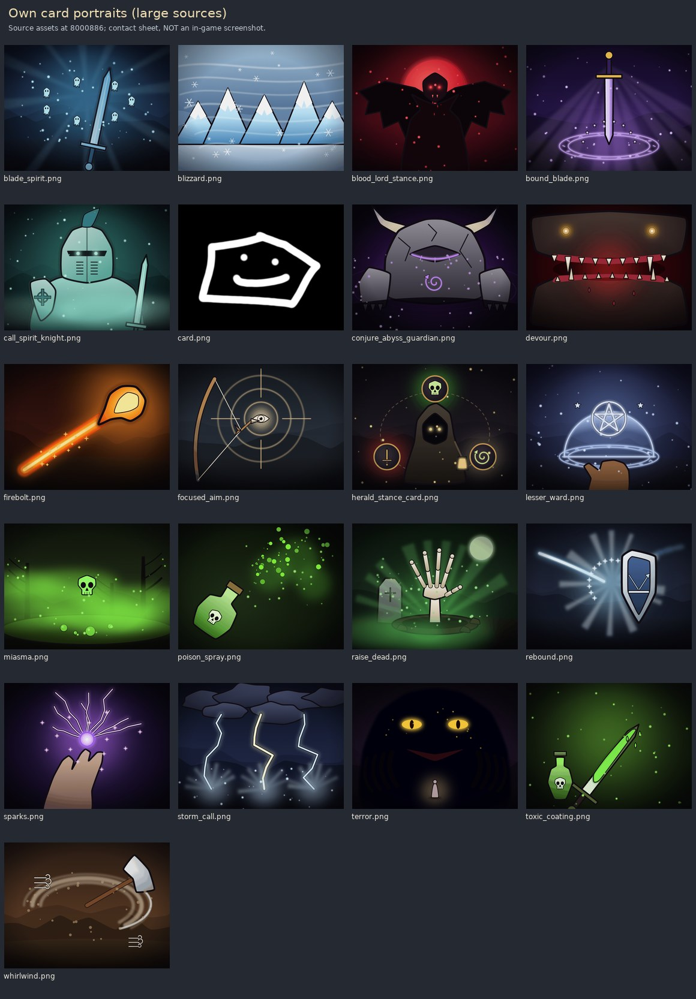

# Slay the Requiem — аудит реализации и готовности

**Дата:** 17 ноября 2026. **Проверенный код:** `8000886e9c52db78227972bdd4740ee71f7eca03` (`main`, после PR #6).

**Задача:** сопоставить замысел RFAB-адаптации и документы 01–19 с реализацией, повторно проверить свежие исправления, разобрать проблемы плейтеста, оценить изображения и определить порядок доведения мода до цельного игрового опыта.

> **Итог:** это большой интеграционный прототип оверхола, а не пустой каркас. Основная RPG-логика действительно написана. Но «система есть в коде», «проверки зелёные» и «система работает в полном забеге и понятна игроку» — три разных состояния. Последнее сейчас не доказано. Обнаружены потери карт/состояния вещей и несколько нарушений контрактов между подсистемами. Наращивать объём контента до их устранения не следует.

Практическое продолжение — [план стабилизации и доведения](../plan/stabilization-roadmap-2026-11-17.md). Исходники в ходе аудита **не исправлялись**: этот документ не является отчётом о закрытых багах.

## Содержание

1. [Границы и результаты проверки](#1-границы-и-результаты-проверки)
2. [Ответы на замечания плейтеста](#2-ответы-на-замечания-плейтеста)
3. [Что изменилось в свежем main](#3-что-изменилось-в-свежем-main)
4. [Ошибки потери состояния и интеграции](#4-ошибки-потери-состояния-и-интеграции)
5. [Контракты механик и дополнительные риски](#5-контракты-механик-и-дополнительные-риски)
6. [Матрица соответствия документам 01–19](#6-матрица-соответствия-документам-0119)
7. [Арт, UI, анимации и звук](#7-арт-ui-анимации-и-звук)
8. [Баланс и необходимость нового контента](#8-баланс-и-необходимость-нового-контента)
9. [Качество архитектуры и тестов](#9-качество-архитектуры-и-тестов)
10. [Рекомендуемый порядок работы](#10-рекомендуемый-порядок-работы)
11. [Источники и воспроизводимость](#11-источники-и-воспроизводимость)

## 1. Границы и результаты проверки

### Что изучено

- Все дизайн-документы `docs/design/01–19`, GUIDE, ROADMAP, technical-plan, completion-plan, art/UI/animation- и card-rework-спеки, CHANGELOG, RFAB digest, предыдущие ревью и ночной план от 17 ноября.
- Основные цепочки ресурсов и оплаты карт, формулы урона, Латы/Раскол, выдача наград, кличи, происхождения/предыстории, вес и сундук, снаряжение, интерфейс ресурсов/лагеря/врагов, настройки забега, сетевые сообщения, акты/карта и Камень Памяти.
- Дополнительно — формы, призывы, праведность и ряд конкретных карт, предметов, врагов и событий. **Не проводилось построчное доказательство корректности каждой карты, каждой фазы каждого босса и всех комбинаций сборок.**
- Закреплённая декомпиляция игры **0.107.1**, используемая CI, и исходники **BaseLib 3.4.8** — для проверки интеграционных предположений.
- Изображения открывались и оценивались глазами, а не только проверялись по именам. В приложении сохранены [14 контактных листов](evidence/audit-2026-11-17/README.md): карты, монстры/формы, реликвии, значки карты, кукла, боевые фоны, события, UI и двери актов.
- Библиотека RFAB просмотрена **выборочно**, вместе с локальной выжимкой: общие принципы, расы/предыстории, навыки, экипировка и пример подробно описанного босса. Не утверждается, что проверена каждая из страниц и таблиц сайта.

### Что НЕ выполнялось

В этой среде нет `dotnet` и Godot/MegaDot в PATH. Не выполнялись полная сборка текущего мода, локальный `dotnet test`, экспорт `.pck`, запуск игры, ручной полный забег, измерение FPS и кооп-прогон. Отсутствие этих результатов нельзя заменить синтаксической проверкой.

У базового коммита `ec598de` есть историческая запись автора об успешной сборке под 0.107.1 и 369 тестах. Это **не наша сборка HEAD `8000886`**. У HEAD подтверждён успешный CI, но сам CI не собирает игровой мод целиком.

### Что проверено автоматически

Выполнены 20 локальных команд проверок, затем отдельно проверены Harmony-цели. Команды и результаты сохранены в [checks.json](evidence/audit-2026-11-17/checks.json) и [check-output.txt](evidence/audit-2026-11-17/check-output.txt).

| Проверка | Результат | Что результат НЕ доказывает |
|---|---|---|
| Python unit tests `tools/sim` | **150 тестов, OK**; есть `ResourceWarning` о незакрытых файлах | Корректность реальных игровых хуков и C#-адаптеров |
| Локализация | 1196 моделей по классификатору, 0 ошибок | Что формулировки понятны и числа верны в динамическом UI |
| C# syntax | 230 файлов, 0 ошибок синтаксиса | Компиляцию, типы, nullability и совместимость всех сигнатур |
| Harmony targets | **98 целей, 0 ошибок** | Установку/порядок патчей и их поведение в работающей игре |
| Каталог/аудит карт | **340 карт**, 0 ошибок, 1 предупреждение | Играбельность, награды, добор и баланс; предупреждение `RendingCut` — ограничение эвристики двух ударов |
| Пулы | 22 исключения, 12 карт открываются превращениями | Фактическую достижимость всех карт в живом забеге |
| События | 33 события проверяемых актовых пулов + событие узла, 0 ошибок | Все ветки выбора, выходы и награды |
| Asset manifest | 895 моделей, **1951 ожидаемый ресурс: 833 своих, 1118 ванильных, 0 отсутствующих** | Что ResourceLoader найдёт и покажет ресурс из экспортированного пакета |
| Реликвии ванили | 295 учтено: 277 остаются, 6 в бижутерию, 12 перерабатываются | Числовой баланс и совместимость всех эффектов |
| Декодирование изображений | **896 PNG/JPG, 0 ошибок** | Художественное качество, размер в бою и правильность Godot-import |
| Art fit / генераторы арта / звук | Проверки прошли | Что временный арт стал финальным или звук хорошо воспринимается |

Счётчики не складываются в «готовность мода»: в 896 изображений входят маленькие/большие версии, контуры, слои и исходные варианты. В 340 картах **189 относятся к Token-пулу**, включая интерфейсные выборы и служебные жетоны. Это не 340 самостоятельных карт для сборки колоды.

[CI run 44068073718](https://github.com/Riyozaki/SlayTheRequiem/actions/runs/44068073718): все три jobs успешны — Core xUnit, Python rules sim, content/syntax/Harmony. Метаданные сохранены; подробный лог xUnit получить не удалось, поэтому количество актуальных xUnit-кейсов здесь не выдумывается.

## 2. Ответы на замечания плейтеста

| Наблюдение | Что установлено | Вывод и следующий шаг |
|---|---|---|
| «Карты то попадают в руку, то нет» | Для кличей исправлен сброс `HasBeenRemovedFromState`; это согласуется с устройством игры. Отдельно перегруз блокирует **добавление в колоду**, а не обычный добор в руку | Разделить добор, возврат клича, генерацию карты и получение награды в логах. Исправление клича обоснованно, но не проверено в бою |
| «Награда без карт / 2 из 3» | В main добавлены защита replacement-хуков и диагностика `Populate`; причина недостающих **видимых** карточек не установлена. Найдена другая определённая цепочка: отказ добавления из-за Груза может завершить обычную награду без получения карты (**A03**) | Не объявлять исходный баг исправленным. Логировать и модели, и создание `NCard`, и результат `Add`, не только длину списка |
| `nope` вместо текстуры | На диске ресурсы декодируются, manifest не находит пропусков; это не тест загрузки `.pck` | Нужны конкретный model id, путь ресурса, версия DLL/PCK и лог импорта/ResourceLoader. Связь с имеющимися `card.png`/`relic.png` не доказана |
| Непонятен Раскол | В текущей формуле это снижение **эффективных Лат**, допускающее отрицательное значение, а не самостоятельный урон | Показать на враге исходные/эффективные Латы и числовой пример; объяснение ниже |
| Нет выбора предыстории / начального бонуса | Происхождения и предыстории реализованы, новые значения по умолчанию — `Choose`. Старые сохранённые настройки могут сохранять автоматический выбор. Знамение — отдельная опция вместо одного дара Нео, не обязательный шаг | Проверить чистый и старый конфиг отдельно. Сделать видимый мастер создания героя; не смешивать предысторию, Знамение и дар Нео |
| Нет красивого собственного UI | Есть свой UI-kit, панели ресурсов, двери актов, подсказки, тосты; многие глубокие действия по-прежнему открывают ванильные card/relic selectors | Функциональные виджеты есть, законченной системы собственных меню нет |
| Слишком много иконок на врагах | Добавлена отдельная компактная строка постоянных черт и свёртка избытка в `+N` | Это полезный фикс плотности, но не доказательство читаемости в конкретном бою; нужен тест с 4–6 существами, призывами и длинными подсказками |
| Лагерь не вмещается, ожидалось новое меню | `NCampChoices` перегруппировывает **ванильные кнопки** и уменьшает их вплоть до 0.42. Это не отдельный экран лагеря | Не считать запрос закрытым. Нужен адаптивный экран с категориями, деталями и закреплёнными действиями, а не ещё более мелкие кнопки |
| Значки карты и арты слабые | После стилизации контуры выразительнее, но многие изображения остаются процедурными символами и геометрическими заготовками | Проблема не только техническая. Нужен утверждённый визуальный эталон, затем замена по приоритету |
| Не удалось далеко пройти | Полный текущий маршрут не прогонялся; стабильность и баланс пяти актов не доказаны | Сначала короткий воспроизводимый вертикальный срез, затем расширение тестов, не очередной длинный слепой плейтест |

### Раскол — объяснение для игрока

Текущая чистая формула находится в `Core/CombatMath.cs:13–23`:

- Эффективные Латы = Латы − Раскол.
- Пробитие игнорирует оставшиеся **положительные** Латы, но само не уводит их в минус.
- Если эффективные Латы отрицательные, удар усиливается на их модуль.
- Раскол уменьшается на 1 в начале хода носителя. Блок обрабатывается отдельно после броневого шага.

**Пример удара 10:** Латы 3 → 7 урона до Блока; Латы 3 и Раскол 2 → 9; Латы 3 и Раскол 5 → 12. Подпись `Латы 3 → −2 (Раскол 5)` объясняет это лучше, чем ещё одна иконка без контекста.

## 3. Что изменилось в свежем main

Проверены изменения после `ec598de`, а не механически перенесены выводы старых ревью.

| Коммит / изменение | Оценка текущего решения | Остаток |
|---|---|---|
| `f7a5102`: возврат кличей | Логика сброса флага перед `CardPileCmd.Add` оправданна. `RemoveFromState` в игре убирает карту из pile и ставит флаг; это **не** удаление регистрации из CombatState | Полная рука, несколько кличей, повторный розыгрыш, конец боя и кооп требуют runtime-тестов. Прежнее подозрение о потерянной регистрации снято |
| `f7a5102`: происхождения/предыстории по выбору | Новые defaults действительно `Choose` | Существующий конфиг не мигрирует автоматически; grant-последовательность неустойчива к прерыванию (**A12**) |
| `f7a5102`, `7e9ecea`: обратная связь Груза | Тосты, подсветка и анимация шкалы реально добавлены | Уведомление не отменяет завершение награды при отказе (**A03**) и не даёт безопасную транзакцию сундука |
| `6d2417f`: выбрасывание карт | Реальный локальный UI с ограничениями, не только текст в плане | Правила необходимо повторно проверять в `Apply`; сейчас индексная ветка обходит `CanDiscard` (**A06**) |
| `6d2417f`: замены наград | Сохраняется upgrade-roll, исключение локального правила не обрывает всю генерацию | Защита не атомарна; ранее сделанные замены и RNG не откатываются (**A11**) |
| `6a4ed90`: Латы/Раскол последним шагом | Устранён прежний риск зависеть от порядка additive-слушателей; учтены caps | Требуется сверка с реальным пайплайном урона, превью, мультиударами и модификаторами. Отдельный текущий баг `True + Sunder` не доказан: найденные явные True-источники — `Unpowered` |
| `c6250cc`: компактные свойства врагов | Постоянные свойства действительно отделены от временных; есть `+N` и общая подсказка | Визуальная приёмка в игре отсутствует |
| `8f666df`: категории лагеря | Улучшена раскладка существующих `NRestSiteButton` | Не выполнен замысел отдельного нового меню (**A15**) |
| `6ba18d7`, `11b7b55`: значки карты/оружие куклы | Контур и штриховка изменены, исходники сохранены | Улучшение обработки не равно полноценной новой иллюстрации/модели |
| `5de3dc1`: симуляции | Появились полезные сигнальные инструменты | Ни один из двух инструментов не является симулятором реального боя пятиактного мода |

Не следует переоткрывать старые F-04/F-07 только потому, что прежнее ревью ожидало другую ману/усталость: текущие half-start + бонус + regen маны и payoff-карты без −25 % соответствуют обновлённому дизайну. Это теперь вопрос баланса, а не автоматически ошибка реализации.

## 4. Ошибки потери состояния и интеграции

**Приоритеты:** P0 — потеря принадлежащего игроку состояния/награды, блокер следующего содержательного плейтеста; P1 — существенное нарушение правила, прогрессии или обязательного UX; P2 — ограниченный дефект, устойчивость или технический долг. «Подтверждено по коду» ниже не означает «воспроизведено запуском игры».

### A01 · P0 · Карта исчезает из сундука при отказе добавления

**Подтверждено по коду.** [`TravelPack.cs:78–88`](../../mod/SlayTheRequiemCode/Alchemy/TravelPack.cs#L78-L88).

`TakeCards` десериализует карту, **сразу удаляет** запись из `_storedCards`, регистрирует экземпляр и вызывает `CardPileCmd.Add`, не проверяя `success`. В той же реликвии `ShouldAddToDeck` запрещает обычные карты, когда текущий перегруз больше 10 (`164–168`). Игра возвращает неуспешный `CardPileAddResult`, а не обязательно исключение.

**Сценарий:** есть карта в сундуке → герой перегружен более чем на 10 → забрать карту → запись уже удалена, в колоду карта не добавляется. При пакетном изъятии возможен частичный успех и потеря оставшейся части после пересечения порога.

**Исправление:** сначала успешно завершить перенос, затем удалить соответствующую запись. При отказе/исключении оставить предмет в источнике, не скрывать отказ за `changed = true`. Сохранить точную идентичность экземпляра/индекса и свойства карты.

**Приёмка:** пороги 10/11, несколько выбранных карт, отказ второго переноса, исключение, upgrade/enchant и save/load. Количество и сериализованное содержимое `колода + сундук` не меняются, кроме явно успешных переносов.

### A02 · P0 · Сундук уничтожает улучшения/чары и восстанавливает заряды вещей

**Подтверждено по коду.** [`TravelPack.cs:51–61, 103–125`](../../mod/SlayTheRequiemCode/Alchemy/TravelPack.cs#L51-L125); [`EquipmentRelic.cs:55–94`](../../mod/SlayTheRequiemCode/Equipment/EquipmentRelic.cs#L55-L94); [`Staves.cs:44–45`](../../mod/SlayTheRequiemCode/Equipment/Staves.cs#L44-L45).

Карты хранятся как `SerializableCard`, а снаряжение — только строкой имён классов. `TakeItem` создаёт свежую каноническую копию. Поэтому теряются `Upgrades`, `Enchants` и специфические SavedProperty, включая `ChargesUsed` посоха. Это одновременно потеря прогресса и возможность бесплатного восстановления зарядов через сундук.

**Исправление:** хранить полноценную сериализацию реликвии с её свойствами и версией формата; предусмотреть миграцию старой строки имён. Не воспроизводить побочные эффекты получения нового предмета как часть обычного перемещения.

**Приёмка:** вещь +2, две разные вещи одного типа, зачарованное кольцо, частично разряженный посох; цикл `снять → положить → save/load → забрать` должен возвращать прежнее состояние и прежнюю надетую сборку.

### A03 · P0 · Отказ Груза не гарантирует сохранение обычной награды

**Подтверждена цепочка для стандартного выбора в проверенной игре 0.107.1; игровой прогон не выполнялся.** Мод: [`TravelPack.cs:164–189`](../../mod/SlayTheRequiemCode/Alchemy/TravelPack.cs#L164-L189). Игра: `CardReward.OnSelect`, строки 234–285 и 298–310 в закреплённой декомпиляции.

При выборе карты ванильный `OnSelect` выставляет `rewardComplete = true` и, если нет эффекта дополнительных выборов, `endSelection = true` **до** `CardPileCmd.Add`. Ветка `success == false` не возвращает эти флаги назад. После отказа награда может завершиться, экран закрыться, карта не будет получена. Новый тост сообщает о перегрузе, но не исправляет управление наградой. Комментарий в моде о том, что карта просто оставалась на экране, этому пути не соответствует.

Это конкретный механизм «нажал взять — не получил». **Он не объясняет автоматически отсутствие самих карточек / 2 видимых варианта из 3 и не доказывает причину именно пользовательского случая.**

**Исправление:** не позволять обычному подтверждению потреблять награду при ожидаемом запрете; дать управление Грузом и повторный выбор. Либо аккуратно сохранить выбор при `Add.success == false`. Один только toast недостаточен. Не обходить все запреты `ShouldAddToDeck` глобально.

**Приёмка:** обычная награда, покупка, scripted reward, сундук; перегруз до выбора и изменение веса во время выбора; upgrade-roll и альтернативная награда; кооп. Награда исчезает только при подтверждённом получении или сознательном пропуске.

### A04 · P1 · Камень Памяти превращает широкую карту в обычную

**Подтверждено по коду.** [`MemoryStoneRelic.cs:154–164`](../../mod/SlayTheRequiemCode/Rollback/MemoryStoneRelic.cs#L154-L164); [`RequiemActs.cs:46–47`](../../mod/SlayTheRequiemCode/Acts/RequiemActs.cs#L46-L47); [`WideActMap.cs:37–63`](../../mod/SlayTheRequiemCode/Acts/WideActMap.cs#L37-L63).

Свежий специальный акт при `WideMaps` создаёт `WideActMap`, но при откате реликвия безусловно строит `StandardActMap` с семью колонками и `replaceTreasureWithElites: false`. Теряются выбранная ширина и соответствующая политика карты. Это особенно важно в моде, где широкие акты, дополнительные элиты и вариации путей — часть дизайна.

**Исправление:** один factory/контракт генерации карты для первого входа и отката, с разными RNG-streams, но одинаковыми структурными правилами. Не копировать ещё одну версию алгоритма в rollback.

**Приёмка:** каждый вариант акта, wide on/off, модификатор сокровищ/элит, повторный откат, save/load и кооп; ширина и ограничения сохраняются, босс прежний, пути и отметки валидны.

### A05 · P1 · Отпечаток снимается не после завершения стартового выбора

**Подтверждено сопоставлением с жизненным циклом игры.** [`MemoryStoneRelic.cs:137–145`](../../mod/SlayTheRequiemCode/Rollback/MemoryStoneRelic.cs#L137-L145), [`MemoryStone.cs:53–65`](../../mod/SlayTheRequiemCode/Rollback/MemoryStone.cs#L53-L65), [дизайн 15 §1](../design/15-death-rollback.md).

Код и техническая заметка предполагают, что `AfterActEntered` означает «Нео/стартовый узел уже закрыт». В игре это не такой контракт:

1. `RunManager.EnterAct(0)` открывает стартовую комнату Нео и затем вызывает `Hook.AfterActEntered`.
2. `EventRoom.EnterInternal` создаёт событие/интерфейс, но **не ждёт завершения выбора**. Для завершённого Ancient существует отдельная обработка `OnEventStateChanged` и pre-finished save.
3. `TakeImprint` вызывает `ToSave(null)`, не сохраняя признак завершённого Ancient.
4. Повторного автоматического снимка после завершения стартового выбора в моде не найдено. В последующих актах хук также не равен выходу из стартового Ancient-узла.

Следствие: дизайн «отпечаток после стартового дара, без перебора выбора» не обеспечен; дар Нео/Знамение могут не входить в исходный отпечаток. Точные видимые последствия при возврате нужно зафиксировать игровым тестом.

**Исправление:** явная точка фиксации после завершённого стартового решения, один раз на акт, после всех стартовых эффектов. Отдельно проверить кооп-барьер: завершили все участники, а не только локальный экран хоста.

**Что не является багом:** обычный `LoadRun` в проверенной игре не вызывает `EnterAct/AfterActEntered` заново. Автоматическое перезаписывание отпечатка при каждом обычном Continue **не подтверждается**. Перенос 50 % Славы в `BuildReturnSave` тоже действительно реализован; основания объявлять его отсутствующим нет.

### A06 · P1 · Валидация действий находится в UI, но не на границе изменения состояния

**Пробелы в коде подтверждены; фактический сетевой рассинхрон/повторная доставка в игре не воспроизводились.** [`ShopActions.cs:99–145, 343–374`](../../mod/SlayTheRequiemCode/Shops/ShopActions.cs#L99-L145), [`RequiemMessages.cs:16–50`](../../mod/SlayTheRequiemCode/Net/RequiemMessages.cs#L16-L50), [`DeckDiscard.cs:27–52`](../../mod/SlayTheRequiemCode/UI/DeckDiscard.cs#L27-L52).

- В `DiscardCard` карта по совпавшему индексу/id берётся **без** `DeckDiscard.CanDiscard`; только fallback-поиск проверяет фильтр. В `Apply` нет повторной проверки «вне боя / перегруз / режим / допустимая карта».
- `Pay` не проверяет достаточность золота и учитывает в доверии запрошенную сумму. Предварительная проверка UI не заменяет проверку после `await` и на всех получателях.
- `Sell` начисляет переданное `a`, даже если перечисленный предмет не найден и ничего не удалено.
- Сообщение содержит kind/a/b/s и location, но не operation id / revision. Повторное выполнение продажи или услуги не защищено доменной идемпотентностью. Привязка к отправителю и месту уже есть — проблема не в полном отсутствии любых сетевых ограничений.
- Получатель вызывает `Apply` напрямую. Несколько async-действий и экраны выбора требуют согласованного порядка, а не надежды на то, что локальная кнопка была доступна.

**Исправление:** единый доменный validator, расчёт цены/выручки из текущего состояния, проверка владения и допустимости цели, защита от повторного выполнения, последовательная обработка с результатом операции. Вынести выбрасывание из «лавочного мешка» либо дать ему полноценную отдельную команду. Дизайн, где все клиенты детерминированно повторяют действие, всё равно требует одинаковых проверок и идентичности экземпляров.

**Приёмка:** недостаточно золота; предмет уже продан; два одинаковых предмета; устаревший индекс; запрещённая/базовая карта; повтор одного operation id; смена комнаты; два быстрых действия. Некорректная команда ничего не меняет ни у инициатора, ни у остальных.

### A07 · P1 · «Поглощение заклинания» и Оберег реализованы уже обещанного правила

**Расхождение с активным текстом дизайна подтверждено.** [Дизайн 03, таблица прочих эффектов](../design/03-elements-statuses.md); [`MagicPowers.cs:31–108`](../../mod/SlayTheRequiemCode/Powers/MagicPowers.cs#L31-L108), [`DestructionSpells.cs:42–59`](../../mod/SlayTheRequiemCode/Spells/DestructionSpells.cs#L42-L59), [`SpellCard.cs`](../../mod/SlayTheRequiemCode/Spells/SpellCard.cs).

Дизайн обещает: Поглощение делает направленное заклинание недействующим и даёт ману; Оберег поглощает урон **и стаки статусов**. Реализация вмешивается в `ModifyHpLostBeforeOsty` и не отменяет самостоятельные эффекты карты.

Пример: `Firebolt.OnPlay` после `Bolt` независимо накладывает Горение, если цель жива. Удаление HP-урона не отменяет эту строку. В просмотренных общих правилах применения статусов есть сопротивления/иммунитеты, но нет эквивалентного контракта поглощённого заклинания. Отдельное недамажное заклинание вообще не обязано пройти через HP-hook. Несколько ударов одной карты также требуют решения: заряд расходуется за заклинание или за попадание?

**Исправление:** сначала утвердить точный контракт. Если сохраняем замысел, нужен контекст заклинания/попадания и согласованное подавление вторичных эффектов; не набор частных проверок только в `Firebolt`. Если сознательно упрощаем до защиты от HP-урона, синхронно изменить дизайн, имена и подсказки. Текущее двусмысленное состояние оставлять нельзя.

**Приёмка:** урон+статус, чистый дебафф, AoE, три попадания одной карты, Свет, отражение, свиток/посох, разные цели и несколько зарядов. Превью не тратит защиту.

## 5. Контракты механик и дополнительные риски

### A08 · P1 · Истинный/чистый урон не имеет единого контракта

**Подтверждено расхождение обещания и различных обработчиков; решение о правильном поведении требует дизайна.** В 02 §4.5 написано «Истинный — игнорирует всё». Однако:

- `InvulnerablePower` обнуляет любой внешний урон (`Powers/ActPowers.cs:54–60`).
- `BrokenPower` умножает любой урон по владельцу (`Powers/EnemyPowers.cs:160–167`).
- `SpectralGuardPower` делит HP-loss пополам без исключения True (`Powers/MagicPowers.cs:295–302`).
- `WardPower` ориентируется на `ValueProp.Unblockable`, а не `DamageType.True` (`Powers/ArmorPowers.cs:82–90`).
- Реакция «Пар» использует `True + Unpowered`, но не `Unblockable` (`Equipment/Jewelry.cs:163–174`), поэтому даже обычный Блок не исключён самим флагом типа.

Нельзя просто добавить `if (True) return` во все защиты: это может сломать обязательную механику неуязвимых фаз боссов. Нужна таблица взаимодействий `тип / powered / blockable / уязвимости / особая защита / фаза`, затем единый helper/контекст и тесты для всех источников. Если True игнорирует только броню/сопротивления, обещание «всё» следует убрать.

### A09 · P2 · Серебро учитывается по наличию в рюкзаке, а не по используемому оружию

**Подтверждено по коду.** `GhostlyPower`, `Powers/ActPowers.cs:43–49`: проверка `Relics.OfType<SilverSaber>().Any()` не требует `IsEquipped`. Снятая серебряная сабля продолжает давать обход Призрачности при другой экипировке. Одновременно обещанный в 03/11 обход Бездонным оружием здесь не выражен через существующий `IAbyssalItem`.

Нужно проверять действующий источник конкретного удара, не наличие трофея в инвентаре. Тесты: сабля надета/снята, другое оружие, заклинание, безоружная атака, Бездонный клинок. Это отдельный дефект правила, не объяснение пропадающих наград.

### A10 · P2 · Зверь может учитывать союзного призыва как труп врага

**Подтверждён слишком широкий предикат; игровой эффект следует воспроизвести.** `WerewolfForm.cs:227–239` увеличивает `_corpses` при смерти любого `Monster`, кроме самого владельца, без проверки стороны или `IsPet`. Реальные призывы мода — именно Monster-питомцы на стороне героя (`SummonPowers.cs:96–107`). Более того, при снятии силы тело призыва уничтожается через `CreatureCmd.Kill` (`172–177`), хотя вытеснение описано как развеивание без гибели.

В дизайне `Пожрать` требует **труп врага**. Сочетание с питомцами/волком Альфы создаёт нежелательный источник лечения/продления формы. Нужны общий контракт смерти против развеивания и предикат допустимого вражеского трупа; полезный уже существующий ориентир — фильтры `Rules/Graveyard.cs`, которые исключают питомцев.

Тесты: смерть врага, смерть своего/чужого питомца, вытеснение призыва, окончание боя и воскрешение. Не «чинить» только один spell, оставив разные определения смерти у форм и Обетов.

### A11 · P2 · `RewardSwap.Guard` не откатывает уже выполненные замены

**Подтверждено по коду.** [`RewardSwap.cs:19–37`](../../mod/SlayTheRequiemCode/Rules/RewardSwap.cs#L19-L37). Хуки героя, заклинаний и Пути последовательно мутируют список и RNG. Если правило заменило первый вариант и упало на втором, catch вернёт `false`, но первая замена и сдвиг RNG останутся. Лог «оставлена без его замен» неверен.

Это не доказанный источник «2 из 3»: сам helper не удаляет слот. Но нет ни атомарного fallback, ни корректного описания частичного результата. Рекомендуется собрать план замены, проверить его целиком, затем применять; отдельно определить поведение RNG при ошибке и порядок трёх правил. Тест — намеренное исключение на второй замене и одинаковый результат у участников коопа.

### A12 · P2 · Начальный grant нельзя надёжно продолжить после прерывания

**Условный путь отказа подтверждён; пользовательский случай не воспроизведён.** [`Grimoire.cs:77–86`](../../mod/SlayTheRequiemCode/Spells/Grimoire.cs#L77-L86): `OriginGranted` устанавливается **перед** `await Pick`, а ранний выход срабатывает и по флагу, и по наличию происхождения. Если выбор/выдача прерваны после происхождения, но до предыстории, повторный вход не довыдаст предысторию. Если сбой произошёл раньше, флаг также может помешать повтору.

Сделать отдельные завершённые состояния каждого шага и идемпотентное продолжение, а не один флаг «начали всё». Проверить Cancel/ошибку/закрытие экрана/save-load, автоматический выбор из конфига и чужие моды. Старый конфиг остаётся отдельной, более простой гипотезой отсутствия выбора.

### A13 · P2 · Не весь статический кэш карты входит в Reset

**Подтверждена неполнота сброса; нормальный игровой сценарий проявления не установлен.** `Acts/ActRuntime.cs:33–36, 129–139`: `ActMarks.Reset()` очищает `_cache`, но не `_lastGate`. Последний ключ состоит только из координаты/акта, без run/seed/map. Формально новый объект карты с той же текущей координатой может получить результат предыдущего контекста.

Обычные входы в комнаты часто успеют перезаписать этот кэш, поэтому это **не доказанный частый баг ворот**. Тем не менее контракт «сброс между забегами» неверен. Включить кэш в run/map-scoped состояние и проверить два забега/две карты на одинаковой координате; отдельно — load и reroll.

### A14 · P1 для соответствия заявленному объёму · Часть оборудования и наград пока только в дизайне

Статический census на HEAD: 87 конкретных наследников EquipmentRelic, из них 11 WeaponRelic, 24 ArmorRelic, 5 MageStaff и 12 PathSign (семейства пересекаются по наследованию, это не складываемые независимые категории). Полный список — [source-inventory.json](evidence/audit-2026-11-17/source-inventory.json).

Несмотря на объём, в конкретных предметах не найдены действующие `Weapon => Spear` / `Crossbow`. Есть enum, формулы, обучение, карты/слои куклы и ссылки на эти типы, но это не равно предмету, который можно получить и использовать. Дизайн 07 также обещает гораздо более широкую лестницу материалов/сетов, 8 масок, уникальные артефакты и конкретные трофеи.

Проверяемый пример: `ActLedger.SuperbossVictory` (`373+`) выдаёт обычную случайную Rare-реликвию, а не конкретный артефакт данного супербосса. Обещанные в 11 §6 «Коса Последнего Вздоха» и «Наковальня Глубин» этим не реализованы. Аналогично среди моделей не найдены «Хвост Бури» и «Расколотый Восход». Поэтому фраза «вся 07 закрыта» не соответствует фактическому покрытию.

**Решение:** не дописывать всё списком за один этап. Завести реестр `обязательное / отложено / сознательно вырезано / заменено другим решением`; сначала обеспечить достижимые классы оружия и значимые трофеи уже существующих боссов. Иначе создаётся ложный выбор сборки: интерфейс и навык обещают специализацию, а предмета нет.

### A15 · P1 для пользовательского опыта · Лагерь и управление героем не доведены до нового меню

**Подтверждено структурой UI, а не измерением клиппинга в игре.** `UI/NCampChoices.cs:53–87` раскладывает ванильные кнопки по рядам, прижимает их вниз и ограничивает scale снизу 0.42. При доступной области меньше минимально требуемой `totalH` всё равно может превысить контейнер; доступной прокрутки/страниц как гарантии fit нет. Дополнительные карточные экраны после каждого выбора не образуют единого меню.

Решение должно быть продуктовым: категории, точки лагеря и причины недоступности сверху, список действий, панель результата справа, независимый от списка выход/подтверждение снизу. Снаряжение, сундук, навыки и магия требуют своих читаемых представлений. Не выдавать ещё одну перераскладку кнопок за выполненный запрос на кастомный UI.

### A16 · P2 · Документы больше не являются единым источником решений

- Верхние статусы README/ROADMAP/дизайнов местами говорят «никогда не собиралось», тогда как в CHANGELOG уже есть историческая сборка и последующий плейтест.
- `04` обещает Бродяге удаление в первом магазине, код делает его сразу на старте (`Backgrounds.cs:149–163`).
- Для Хладовяза обещано дополнительное владение Разрушением; `FrostbinderBackground` заменяет карту и даёт ауру, но не вызывает `RaiseMastery` (`204–213`).
- Формулировки момента получения Пути, завершённости контента 07 и стадии визуала расходятся между документами.
- Генерируемые таблицы карт сверяются **с кодом, из которого построены**. Это полезно для синхронности, но не независимое доказательство соответствия исходному замыслу.

Не надо массово переписывать всё под текущие ошибки. Нужны короткий список принятых решений, разделение «замысел / реализация / проверено в игре» и явные ссылки на отклонения. Старые ревью должны оставаться историей, а не одновременно действующими списками задач.

## 6. Матрица соответствия документам 01–19

Шкала без искусственного процента: **код есть** — найден действующий механизм; **частично** — есть каркас/часть содержимого либо не совпадает контракт; **runtime не подтверждён** — это относится ко всем строкам, а не только к отмеченным рискам.

| Документ | Реальная опора в реализации | Что не позволяет считать систему завершённой |
|---|---|---|
| **01 Видение** | Ресурсы, вес, стихии, сборки врагов, цена даров перенесены системно | Главный столп «читаемость прежде всего» пока проигрывает объёму правил и интерфейсному шуму |
| **02 Базовые статы** | Core, ресурсы, stamina payment, мана, Груз, прогрессия Славы, защиты | A01–03, A08; экономика пяти актов не проверена, причины запрета должны быть видны до действия |
| **03 Стихии/статусы** | Горение, Озноб/заморозка, Статика, яд/хворь, кровь, Свет, Раскол, реакции | A07–09; важны порядок хуков, rounding, shield/status и multi-hit, не только чистая формула |
| **04 Герои/происхождения** | 3 героя в системе, 10 происхождений, 31 модель предыстории, выбор/автовыбор | Старые настройки, A12, несогласованные стартовые бонусы; нужна проверка стартовой сборки каждого героя |
| **05 Пантеон** | Знамения у Нео, вера/грех/искупление, благословения, дары/обеты, события | Знамение необязательно; это нужно объяснить. Сложные кросс-эффекты и завершение Обетов в игре не прогонялись |
| **06 Пути/превращения** | Пути, знаки, вампир/оборотень/договор-Вестник-Лич/праведная форма; отдельные визуальные облики | A10, выход/повторный вход в форму, temporary deck и отключение экипировки требуют интеграционных тестов |
| **07 Снаряжение/реликвии** | Слоты, сводные бонусы, надевание/снятие, улучшения/чары, бижутерия, посохи, таблица ванили | A02/A09/A14; предметная прогрессия не закрыта наличием общего enum или иконки |
| **08 Магия** | 42 модели Spell-пула, 5 школ, владение/предрасположенность, свитки, 5 посохов, настоящие питомцы | A07/A10; синхронизация силы/тела призыва, доступность и цена заклинаний после скидок |
| **09 Алхимия** | Реагенты, рецепты, зелья/яды/настои, ограничения применения и сервисы | Не проверены все рецепты/стэки/цели. Добыча ресурсов и ценность относительно лагеря/магазина требуют телеметрии |
| **10 Лагерь** | Очки, восстановление/усталость, ремесло, тренировка, сундук, мул/таверна | A01/A02/A15. Механики существуют, законченного лагерного UX пока нет |
| **11 Враги** | Разметка ванили, ресурсы/защиты/аффиксы, свои элиты, 12 боссов четырёх вариантов новых актов, супербоссы и фазы | Каждый бой/переход фазы не проверен. A07–10/A14; дроп и читаемый контрплей важнее ещё одного босса |
| **12 Словарь** | Есть собственный нейминг и RU/EN JSON; покрытие автоматизировано | Проверка ключей не проверяет смысл, единообразие терминов True/чистый/Истинный и качество английского |
| **13 Акты/карта** | Пять актов, варианты 2/4, wide-map, маршруты/карманы/закрытые переходы, отметки/события, двери | A04/A13, достижимость и восстановление из save. Обычные бои новых актов во многом заимствованы — это осознанная текущая реализация, не уникальный полный бестиарий |
| **14 Магазины** | Виды лавок, витрины, услуги, доверие, кражи, заказы, наставник | A06; фиксированные слоты ванильного магазина ограничивают UX, сложные услуги спрятаны в дополнительных выборах |
| **15 Камень Памяти** | SerializableRun snapshot, свечи/шрамы/месть, перенос части Славы, счёт, кооп-протокол | A04/A05; нужны серии повторных откатов и проверка дискового отпечатка, миграции и переподключения |
| **16 Карты Латоносца** | 44 модели hero-пула, оружие/щит/кличи и fatigue payoffs | Часть карт проверена выборочно; числовой каталог и value-report не доказывают рабочие архетипы |
| **17 Карты Безмолвной** | 20 моделей hero-пула, скрытность/яд/кинжалы и условные эффекты | Проверить стартовую слабость, добор/защиту и доступность payoff-карт; не выравнивать количество с Латоносцем механически |
| **18 Регент и общие карты** | 12 Regent, общие заклинания, карты Путей/форм и жетоны | Реальная магическая специализация зависит от владения/награды/экипировки. 189 Token не считать полезными боевыми картами |
| **19 Пулы** | 22 исключения, 12 gated-карт, замены на карты героя/школы/Пути | A11 и исходный кейс 0/2 из 3. Нужен seed-based прогон реального CardFactory с разными unlock-состояниями |

**Оценка стадии:** большая часть механического каркаса написана; контентная полнота неодинакова; интеграционная приёмка, читаемость и визуальная полировка существенно отстают. Честной общей цифры «готово на 85 %» из этих данных получить нельзя.

## 7. Арт, UI, анимации и звук

### Что именно просмотрено

Исходные листы во время аудита: 21 большой портрет карты; 58 спрайтов монстров/призывов/форм; 198 больших иконок реликвий; 20 значков карты; 20 слоёв оружия/металла куклы; 10 боевых фоновых/передних слоёв; 34 картины событий; 28 UI-изображений и 4 двери. 15 слоёв пергамента карты и 5 лагерных фонов входят в технический census, но не объявляются здесь отдельно отсмотренными в игровом масштабе. Малые/большие версии не считаются разными художественными произведениями.

[Галереи и точные пути источников](evidence/audit-2026-11-17/README.md). **Это контактные листы ассетов, не скриншоты из игры.**

### Художественная оценка

| Группа | Что уже полезно | Почему пока не финал |
|---|---|---|
| **Портреты карт** | Контраст, понятная центральная эмблема, воспроизводимый pipeline | В основном предмет/знак по центру на фоне. Это ближе к увеличенной иконке, чем к сцене действия карты. Не хватает характера, пластики, композиции, героя и визуального рассказа |
| **Монстры/формы** | Различаются цвета фракций, общие архетипы, силуэты/варианты фаз | Сильная геометричность и симметрия, похожие стойки, однообразные лица и конечности. Перекраска/добавленный контур не превращают прототип в выразительного противника |
| **Реликвии** | Хорошая базовая разметка категорий, многие знаки различимы | Повторяются основы, кольца, амулеты и контуры. Для важной награды босса недостаточно очередного символа на похожей подложке. Совпадение outline само по себе не ошибка — проверять надо различимость итоговых предметов |
| **Значки карты** | Новый контур и штриховка приблизили их к пергаменту | Часть напоминает набор эмодзи/пиктограмм. При 64 px штриховка может исчезать или шуметь. Нужна ручная проверка на фоне карты, в visited/hover/blocked состояниях |
| **Кукла/оружие** | Есть отдельный металлический слой и цвет материала, предметы более заметны после свежего фикса | Пока это наложенные пиктограммы на базовую фигуру. Нет полноценного ощущения надетой сборки: хват, перспектива, пропорции и привязки требуют арт-дирекции |
| **События** | 34 читаемые тематические сцены; доминирующие объекты различимы | Сцены собраны из нескольких повторяемых задников и простых геометрических фигур. Силуэты персонажей, выразительность и предметный масштаб слабее ожидаемого финального уровня |
| **Фоны/двери** | Холод/латунь/кровь/звёзды хорошо различаются; двери — полезный визуальный элемент выбора | Во многом гладкие процедурные градиенты и узоры. Нужны фактура, глубина, свет и сопоставление с ванильными персонажами/боевым UI |
| **UI-глифы** | Многие простые знаки ресурсов/стихий вполне годятся как основа | Простой glyph здесь уместен — не нужно превращать каждую иконку в картину. Нужны единая толщина/контраст, различимость без цвета и проверка небольшого размера |

Характерный пример текущего языка карт:



**Рекомендация:** не генерировать ещё сотню изображений тем же способом ради закрытия manifest. Сначала утвердить небольшой набор эталонов и проверить его в настоящем кадре игры. Кодовые SVG-генераторы оставить для схем, глифов, прототипов и вспомогательных ассетов; финальные сценические иллюстрации оценивать как иллюстрации.

### UI: чего не хватает до цельного продукта

1. **Старт героя:** связанная последовательность «происхождение → предыстория → итог сборки», с явно отличимым дальнейшим Знамением/даром Нео. Автовыбор из конфига должен быть видим, а не выглядеть сломанным экраном.
2. **Постоянный лист героя:** итоговые HP/◆/✦/вместимость, источники бонусов, навыки, школа/ступень, вера/обеты/форма. Не заставлять вспоминать, какая служебная реликвия хранит нужное правило.
3. **Инвентарь:** надетое/рюкзак/сундук, сравнение «было → станет», вес и свойства экземпляра, безопасное снятие/выбрасывание. Общий экран выбора реликвии — временный интерфейс, не полноценный инвентарь.
4. **Лагерь:** отдельный адаптивный экран и понятная цена действия/оставшиеся очки. Повторные card selectors могут остаться низкоуровневым механизмом выбора карты, но не навигацией всего лагеря.
5. **Награды/магазин:** заранее показывать вес, запрет и способ разгрузиться. Не объяснять уже потерянную награду исчезающим toast.
6. **Враги:** по умолчанию — намерение, существенные ресурсы, несколько важных защит; остальное — раскрываемый паспорт врага. Постоянные и временные эффекты визуально различать. В текущей реализации свёртка уже есть — дорабатывать приоритеты/иерархию, а не добавлять вторую идентичную строку.
7. **Карты:** финальные стоимости и их причины должны совпадать с оплатой. Подсказки для ванильных карт тоже обязательны: большая часть боя всё ещё использует их.

### Анимации и звук

`OwnArtAnimator` действительно переводит игровые триггеры в PNG+tween: idle, attack/cast, hurt, death, revive, смена картинки. Это лучше статичной картинки и обеспечивает техническую жизнь модели, **но не равно полноценной персонажной анимации**: нет отдельных поз/деформаций тела и убедительной постановки большинства действий.

Следующий шаг — не обязательная массовая миграция в Spine. Можно сделать слоёные 2D-риги/покадровые ключевые позы для важных существ, общий словарь коротких VFX и предсказуемые переходы фаз. Асинхронная анимация должна безопасно отменяться при выходе из сцены и не управлять истинностью боевого результата.

Проверка звуков находит 7 собственных WAV суммарно 6.6 секунды плюс ванильные маршруты. Звук **не прослушивался**: качество, громкость, навязчивость и смешивание не оценены. Пути и длительность не заменяют слуховую приёмку.

## 8. Баланс и необходимость нового контента

### Что говорят уже имеющиеся инструменты

Запущены:

```text
python tools/sim/burden_sim.py --runs 4000 --seed 7
python tools/cards/balance_report.py --out <audit-evidence>/card-balance-proxy.md
```

**Burden sim** моделирует экономику веса на 45 условных этажах. Это не бой и не реальный маршрут пяти актов примерно на 69 комнат: нет настоящих наград, магазинов, сундука, решений игрока и большинства коррелированных эффектов.

| Политика модели | Латоносец: >10 | Безмолвная: >10 | Регент: >10 |
|---|---:|---:|---:|
| Берёт 70 % карт, удаляет в магазине | 61 %, медианный этаж 39 | **96 %, этаж 31** | **95 %, этаж 31** |
| То же, с политикой вложения очков в Груз | 18 %, этаж 41 | 50 %, этаж 38 | 51 %, этаж 38 |

Медиана этажа — среди траекторий, дошедших до соответствующего порога, а не гарантированная точка каждого забега. [Полный вывод](evidence/audit-2026-11-17/burden-proxy.log).

Это **сигнал проверить**, не доказательство «надо немедленно увеличить вместимость на N». Возможная проблема замысла: если инвестиция в Груз или постоянное избавление от новых наград становится обязательным налогом для двух героев, «интересный выбор» превращается в неприятную обязанность. В реальной модели должны появиться сундук, мул, снятые предметы, облегчение, цена удаления и легальные пути выхода из перегруза.

**Card value report** — ручные веса `урон + Блок + статусы` делённые на `⚡ + 0.5◆ + 0.5✦`. Эвристика помечает выбросами, например, `FlatStrike`, `FireBreath`, `ShieldCharge`, `PickPocket`. Но она не оценивает полноценно кличевые cooldown, вторичные эффекты, контекст сборки и экономику ходов. Даже пометка «без условий в тексте» не гарантирует отсутствие условий в коде. **Это список для ручной проверки, не автоматический список баффов/нерфов.**

### Как проверять баланс по существу

- Разделить **силу стартовой колоды**, **вероятность собрать рабочую специализацию**, **средний темп боя**, **предел сильной сборки** и **цену пятиактной длины**.
- Проверять одновременно три бюджета: энергию действий, запас/regen выносливости и маны. Одинаковая линейная цена не описывает, насколько ресурс ограничивает конкретного героя.
- Считать ходы без полезного действия, недоступные карты в руке, HP loss/бой, время/число ходов, избыточную генерацию, контроль противника, использованные/отвергнутые награды и причину отказа.
- Для врагов проверять **телеграфирование и контрплей**, а не только HP/DPS: есть ли у доступных герою инструментов ответ на броню, неуязвимость, контроль, снятие маны, массовые удары и призывную свиту.
- Отдельные опасные сочетания: многоудар + Латы/Раскол; халявные атаки + стаки/оружие; кличи + копирование/повтор; отражение/плащи + цепной урон; свет + нежить; оглушение/Слом + смена фаз; истинный урон + особые защиты; формы + сохранённые карты/питомцы.

### Нужно ли добавлять карты, врагов и боссов

**Сейчас — не массово.** Hero-пулы 44 / 20 / 12 неодинаковы, но игра не ограничена ими: ванильные карты остаются, есть 42 заклинания и 33 карты Путей. Равное количество не является целью.

Добавлять карту следует только под выявленную дыру: доступный ранний ответ на броню, добор/защита конкретного архетипа, bridge-карта для перехода к школе или инструмент разгрузки. Сначала составить матрицу доступности по актам/редкостям/предысториям и проверить реальные награды. Нельзя балансировать героя вокруг карты, которую его reward-пайплайн почти не выдаёт.

У боссов уже достаточно фаз и подсистем, чтобы надолго загрузить тестирование. В ближайшем цикле полезнее довести **существующий бой + его контрплей + понятный трофей + визуальное представление**. Нового противника добавлять, если он решает конкретную проблему разнообразия/проверки сборки, а не закрывает ещё одну строку счётчика.

Исключение — **необходимые недостающие звенья уже обещанной сборки** (A14): предметы для действующих классов оружия, ясная progression-лестница и подписные награды. Их нельзя бесконечно прикрывать общим словом «контент позже».

## 9. Качество архитектуры и тестов

### Что стоит сохранить

- Выделение чистых правил в `Core/`, отдельный тестовый проект без зависимости от игры.
- Закреплённые версии API, проверка Harmony-целей, изоляция установки патчей и `CriticalPatch → Degraded`. Это полезные страховки против обновлений EA, хотя graceful degradation не равен полностью безопасному смешанному забегу.
- Общие классы карт/заклинаний/снаряжения и data-driven разметка ванильных карт, монстров, реликвий.
- Снимок игровых настроек в забеге и передача настроек лобби. При загрузке State присваивается до применения run-settings: прежнее подозрение в обратном порядке снято.
- Генераторы локализации, каталогов, покрытия и ресурсов. Это сильная основа для систематической поддержки большого оверхола.
- Детерминированные отдельные RNG-streams для ряда картографических решений, а не случайность от времени машины.

**Переписывать проект с нуля не требуется.** Требуется довести границы операций и замкнуть интеграционные контракты.

### Главные технические долги

1. **Транзакционность.** Удаление из источника/оплата/побочные эффекты часто происходят до подтверждённого завершения. Catch пишет предупреждение, но не восстанавливает состояние. A01/A02/A06/A11 — разные проявления одной проблемы.
2. **Контекст эффекта.** Разрозненные hooks знают часть информации: тип урона, spell/source, флаги powered/unblockable, сторона и фаза. Нет единого описания взаимодействий защит/заклинаний/вторичных эффектов.
3. **Жизненный цикл.** Статические флаги, кэши, экраны и переходы между новым забегом, Continue, смертью, rollback и коопом необходимо проверять как state machine. Название игрового хука нельзя трактовать по бытовому смыслу.
4. **Сетевые команды.** Нужны идентичность операции/экземпляра, валидация и порядок. Наличие targeted-message не обеспечивает эти свойства автоматически.
5. **Подмена критериев качества.** Проверка файла, синтаксиса или совпадения генератора не доказывает достижимость контента, внешний вид в игре и соответствие замыслу.
6. **Документация решений.** Добавление новой «сводки готовности» без закрытия противоречий увеличивает долг. Нужен один текущий реестр и короткие принятые решения.

### Оптимизация: без выдуманных замеров

Признаков, достаточных для заявления «основная причина лагов — X», нет: профилирование не проводилось. Не стоит заранее переписывать весь LINQ.

Есть конкретные места для измерения:

- `NEnemyTraitChips` собирает/сортирует свойства и перерисовывается в `_Process`; при большой свите проверить CPU/аллокации и перейти к обновлению по изменению состояния, сохранив лёгкую анимацию отдельно.
- `Loadout.Bonuses/TotalWeight` многократно обходят коллекции. Некоторые виджеты **уже ограничены частотой обновления**: например, NBurdenMeter считает вес раз в 0.25 с, а не каждый кадр. Возможный cache вводить только с чёткой инвалидацией по событиям экипировки/колоды/чар/формы.
- Дубли размеров/слоёв и исходники в экспортируемом дереве — проверить фактический PCK/GPU footprint, загрузку и выгрузку. 41 MB файлов на диске не равны расходу видеопамяти.
- Убивать/отменять tweens, отписывать события и завершать ожидающие выборы при уходе со сцены; профилировать серии боёв/открытий меню, а не один кадр.
- Диагностические логи делать информативными и включаемыми; массовая запись каждой перерисовки сама станет проблемой.

### Каких тестов не хватает

Текущие xUnit-тесты включают `Core/**/*.cs`; они не компилируют весь игровой слой и не исполняют `TravelPack`, `ShopActions`, `Grimoire`, `CardReward` или Godot-сцены. Python-зеркало правил полезно, но может повторить ту же ошибку либо разойтись с C#.

Нужны три разных уровня:

1. Чистые правила и property-based инварианты — без игры.
2. Интеграционные сценарии на реальном API/моделях игры: создание награды, добавление карты, сериализация экземпляра, фазы, откат, сетевое применение.
3. Реальные UI/игровые/кооп-прогоны с логами и скриншотами. Только они проверяют `nope`, клиппинг, input/focus и субъективную читаемость.

## 10. Рекомендуемый порядок работы

Подробные задачи, зависимости и критерии выхода — в [отдельном плане](../plan/stabilization-roadmap-2026-11-17.md). Короткая последовательность:

1. **Зафиксировать проверяемый baseline:** точные DLL/PCK/игра/BaseLib/настройки и debug-сценарии. Собрать именно текущий игровой слой.
2. **Закрыть потери состояния:** A01–03, сериализация вещей, общая валидация A06. В той же линии — диагностировать исходные 0/2 из 3 на реальном CardFactory и NCard.
3. **Довести контрактный минимум:** snapshot A05, карта A04, A07/A08, формы/питомцы и восстановление начала героя. Написать регрессии до следующей большой партии контента.
4. **Пройти короткий вертикальный срез каждым героем** на чистом и старом конфиге. Только затем давать пользователю длинный плейтест.
5. **Сделать настоящий UX-слой:** создание героя, лист героя/инвентарь, лагерь, награды/магазин, паспорт врага. Параллельно — небольшой утверждённый арт-эталон.
6. **Балансировать реальный цикл** и восполнить только подтверждённые дыры сборок/трофеев, затем расширять симуляции и маршруты.
7. **Серийно заменить прототипный арт**, довести анимацию/звук, профилировать и завершить полную соло/кооп-матрицу.

**Не делать сейчас:** новые масштабные подсистемы; ещё десятки боссов/карт ради количества; массовые баффы по value-report; «финальный» арт без эталона; объявление всех ошибок плейтеста исправленными по зелёному CI.

## 11. Источники и воспроизводимость

### Репозиторий

- Код: HEAD `8000886e9c52db78227972bdd4740ee71f7eca03`; 224 C#-файла основного слоя, около 42 137 строк. Это масштаб, не оценка качества.
- План/замысел: `docs/design/01–19`, `docs/plan/*`, GUIDE, ROADMAP, technical-plan и CHANGELOG на этом HEAD. Ссылки на строки кода выше относятся к проверенному состоянию, а не к будущему исправлению.
- [Сохранённые доказательства и галереи](evidence/audit-2026-11-17/README.md): команды, вывод, CI-метаданные, census, инвентарь моделей и прокси-отчёты.

### Внешние опоры

- [RFAB Library](https://skyrimrequiem.ru/pages/library/) — источник фантазии и системных различий: ресурсы, оружие/защиты, специализации, цена решений. Прочитаны выбранные разделы, не весь сайт.
- [Ригель Сильная Рука](https://skyrimrequiem.ru/pages/library/bosses/rigel-silnaya-ruka.html) — пример босса как сборки из оружия, брони, особой защиты и свиты. Это полезнее для адаптации, чем прямой перенос Skyrim-чисел в StS.
- [Закреплённая декомпиляция 0.107.1](https://github.com/zhiyue/sts2-rl-agent/tree/5d874e855ae1d0550d5c30416fadd7dbb0d133b7/decompiled): `CardReward`, `CardPileCmd`, `CardModel`, `CombatState`, `RunManager`, `NGame`, `EventRoom`, `AncientEventModel`, `StandardActMap`, hooks.
- [BaseLib v3.4.8](https://github.com/Alchyr/BaseLib-StS2/tree/v3.4.8), commit `6fc4adb72556f2f30a57e540dbe7722ce0827aa8` — модель hooks, custom models и UI-интеграция.

**Принцип адаптации:** сохранять не количество предметов и не проценты Skyrim, а опыт «сборка имеет сильные стороны, цену и читаемые ответы». Сейчас самый большой разрыв с этой идеей — не нехватка ещё сотни карт, а непредсказуемость отдельных операций, слабая объяснимость и незавершённое визуальное представление.
